# P0-04: Write conversation flow designs

## 1. Summary
Design every conversation the AI receptionist handles: new booking (new and existing patient), reschedule, cancel, check an appointment, FAQ, emergency and callback. Produce:
- the **authoritative state machine** as a YAML transition table (`docs/flows/state_machine.yaml`), with the states, events, guards and allowed tools that P2-01 implements;
- one Mermaid diagram and step table per flow in `docs/flows/`;
- the global interrupts that apply in every state;
- one synthetic "golden" conversation per flow for evals.

Done means: the YAML validates; every state from plan §4.1 (plus the added ones) appears in at least one flow; every state is reachable and has an exit; and the tech lead and the clinic SME have reviewed the flows.

## 2. Why this matters
The plan's core design rule is "the LLM talks, deterministic code acts" (§1 principle 2, §4.1). A **deterministic state machine** owns the conversation, and the model only understands and phrases. That only works if the state machine is fully specified before code starts.

Plan §4.1's list (`GREETING → INTENT → IDENTIFY/REGISTER → VERIFY → APPOINTMENT_TYPE → AVAILABILITY → CONFIRM → BOOK → WRAP_UP`, plus `EMERGENCY`, `CALLBACK_REQUEST`, `RESCHEDULE`, `CANCEL`) has no states for checking an appointment, FAQ, WhatsApp consent or ending the session. It also doesn't say how the side branches return to the main flow.

Without this task:
- P2-01 would invent the state list;
- P2-08 (which tools may be called in each state) and P2-09 (preconditions such as "book only after explicit confirmation") would have nothing to enforce;
- P0-14 couldn't show where PHI is collected.

Patients feel the effect in every conversation: the AI never asks twice for data it already has, never reveals records before verification, and always has a way out to a callback.

Plan references: §1, §2 (patient capabilities), §4.1, §4.2, §4.4 (read-back), §4.5, §4.6, §4.7, §4.8, §4.9.

## 3. Background you need
- **Project in one paragraph:** We are building an MVP of a web-based AI receptionist for US dental clinics. Patients talk (voice) or type (chat) on the clinic's website. The AI identifies or registers them in **Open Dental** (the clinic's practice-management system and our source of truth), books, reschedules or cancels real appointments, sends WhatsApp confirmations and reminders, and escalates emergencies. When it can't resolve something, it creates a callback case and emails the clinic admin (there is no live transfer). It runs on Google Cloud: Gemini on Vertex AI, Google Speech-to-Text and Text-to-Speech, a Python FastAPI backend on Cloud Run, Cloud SQL Postgres and Redis, with a Next.js frontend. Key rules: the LLM only talks and extracts, while deterministic code decides and acts; we store only Open Dental IDs (PatNum, AptNum), never copies of patient records; no PHI goes to any vendor without a signed BAA; and the system must be HIPAA-ready from day one. Work runs in phases: P0 discovery & compliance → P1 core platform + Open Dental adapter → P2 text chat → P3 voice and P4 WhatsApp + admin console (in parallel) → P5 hardening → P6 pilot. This task belongs to **P0, Discovery & Compliance Foundation**.
- **State machine:** the conversation is always in exactly one **state**. A user turn or a tool result produces an **event**. A **transition** `(state, event, guard) → next state` decides what happens next. Code decides transitions; the LLM never does.
- **Guard:** a yes/no condition checked before a transition, e.g. `verified` (the patient was verified in this session). P2-09 enforces guards on tool calls.
- **Slot memory:** structured data collected in the session (name, DOB, reason…). It is not the same as appointment *time slots*. Only missing slots are asked for (§4.1, P2-02).
- **Tools (§4.2):** backend functions the LLM may request through the **tool gateway**: `search_patient`, `verify_patient`, `create_patient`, `get_appointment_availability`, `get_patient_appointments`, `book_appointment`, `reschedule_appointment`, `cancel_appointment`, `get_clinic_information`, `get_provider_information`, `create_callback_request`.
- **Identification outcomes (§4.5):** strong match → verify; partial (e.g. phone only) → ask for another identifier; multiple → disambiguate, otherwise callback; none → confirm spelling and DOB, then register. Never confirm "you are a patient here" before verification.
- **Reason codes (P0-02):** the fixed list the model classifies the visit reason into; config maps each one to an appointment type or to `callback` / `not_offered`.
- **Emergency results (P0-03):** `tier1`, `crisis`, `uncertain`, `tier2`, `tier3`, `none`. The rules run on every user turn, and each result has a fixed action.
- **Callback case (§4.9):** when the AI can't resolve something it collects details, reads back name and phone, creates a case and emails the admin. There is no live transfer.
- **Mermaid:** a text format for diagrams that GitHub renders inside Markdown (https://mermaid.js.org/syntax/stateDiagram.html).

## 4. Scope
**In scope**
- The canonical state list, events, guards, transition table and global interrupts (YAML + JSON Schema).
- The allowed tools and collected slots (with PHI flag) for each state.
- Eight flow documents with a Mermaid diagram and a step table, plus an overview with the full state diagram.
- One golden synthetic conversation per flow (YAML).
- A WhatsApp consent step (`CONSENT`) after a successful booking or reschedule.
- Review by the tech lead and the clinic SME.

**Out of scope** (and which task covers it)
- Implementing the state machine → P2-01
- Slot memory storage and encryption → P2-02
- Exact prompts and reply wording → P2-07 (flows give intent of each reply, not final text; emergency scripts are fixed in P0-03)
- Tool JSON schemas and tool allow-list enforcement → P1-22, P1-23, P1-24, P2-08
- Guard enforcement (fresh availability, session scoping) → P2-09
- Matching/scoring rules, verification policy → P2-13, P2-14 (clinic values from P0-01 Q1)
- Emergency detection rules and scripts → P0-03
- Consent storage and wording → P4-02; WhatsApp opt-out (happens inside WhatsApp) → P4
- Voice-specific timing (endpointing, barge-in, fillers) → P3. Flows are the same for voice and text.
- PHI data-flow diagram → P0-14 (uses the per-state PHI notes from here)

## 5. Dependencies and how to start without them
| Depends on | What you need from it | How to work before it is done |
|---|---|---|
| P0-01 Discovery workshop (approved spec) | Q1 verification identifiers, Q2 new-patient review, Q5 cancellation window, Q6 insurance scope, B4 auto-create new patients, B6 callback promise | Use the Proposed defaults listed in the P0-01 questionnaire. Mark each place that depends on an answer with `(P0-01 Qn)` so it can be updated when the answer arrives. |
| P0-02 Appointment-type mapping (approved spec, soft) | Reason codes and `when_not_bookable` actions | Use the 15 codes and the actions as specified. |
| P0-03 Emergency protocol (approved spec, soft) | Emergency results and tier actions | Use the result values and the tier-action table as specified. |

## 6. Interface contract

### Files (Proposed)
| Path | Content |
|---|---|
| `docs/flows/state_machine.yaml` | Authoritative states, events, guards, transitions, global interrupts |
| `docs/flows/state_machine.schema.json` | JSON Schema for the YAML (below) |
| `docs/flows/overview.md` | Full state diagram, global interrupts, slot list, how side branches resume |
| `docs/flows/book-existing-patient.md` | Flow 1 |
| `docs/flows/book-new-patient.md` | Flow 2 |
| `docs/flows/reschedule.md` | Flow 3 |
| `docs/flows/cancel.md` | Flow 4 |
| `docs/flows/check-appointment.md` | Flow 5 |
| `docs/flows/faq.md` | Flow 6 |
| `docs/flows/emergency.md` | Flow 7 |
| `docs/flows/callback.md` | Flow 8 |
| `evals/golden/<flow>.yaml` | One golden conversation per flow (8 files) |

If the YAML and a diagram disagree, **the YAML wins** and the diagram is fixed.

### States (Proposed; extends plan §4.1)
| State | Kind | Purpose | Allowed tools | Slots collected (PHI?) |
|---|---|---|---|---|
| `GREETING` | main | Greet, set expectations (AI receptionist, no medical advice) | - | - |
| `INTENT` | main | Find out what the patient wants | - | `intent` |
| `IDENTIFY` | main | Collect identifiers, search Open Dental, react to match outcome | `search_patient` | `first_name`, `last_name`, `dob`, `phone` (PHI) |
| `VERIFY` | main | Confirm identity per clinic policy (≥ 2 identifiers, never phone alone) | `verify_patient` | extra identifier, e.g. `zip` (PHI) |
| `REGISTER` | main | Collect new-patient details, read back, create if no ambiguity (P0-01 B4) | `search_patient`, `create_patient` | `email`, `address`, `mobile_phone` (PHI) |
| `APPOINTMENT_TYPE` | main | Classify the reason, map it to a type via config (no LLM decision) | - | `reason_code`, `reason_text` (PHI) |
| `AVAILABILITY` | main | Fetch real slots, offer 2–3, handle "something later" | `get_appointment_availability` | `preferred_time`, `chosen_slot` |
| `CONFIRM` | main | Read back the operation, date, time and provider; get an explicit yes | - | `confirmation` |
| `BOOK` | main | Commit the operation (book / reschedule / cancel); verify in Open Dental | `book_appointment`, `reschedule_appointment`, `cancel_appointment` | `apt_num` |
| `CONSENT` | main | Ask for WhatsApp confirmation/reminder consent if none is on record | `record_consent` (Proposed, new) | `consent_whatsapp`, `whatsapp_number` (PHI) |
| `WRAP_UP` | main | Summarize, ask "anything else?" | - | - |
| `END` | terminal | Session closed | - | - |
| `CHECK_APPOINTMENT` | side | List this verified patient's upcoming appointments | `get_patient_appointments` | - |
| `RESCHEDULE` | side | Pick which appointment to move, check policy (P0-01 Q5) | `get_patient_appointments` | `apt_num` |
| `CANCEL` | side | Pick which appointment to cancel, check policy (P0-01 Q5) | `get_patient_appointments` | `apt_num` |
| `FAQ` | side | Answer from clinic config (hours, address, insurance list), then resume | `get_clinic_information`, `get_provider_information` | - |
| `EMERGENCY` | side | Run the P0-03 tier action | `create_callback_request`, `get_appointment_availability` | `situation` (PHI) |
| `CALLBACK_REQUEST` | side | Collect details, read back name + phone, create the case, tell the patient (§4.9) | `create_callback_request` | `situation`, `callback_time`, contact details (PHI) |

`operation` (book / reschedule / cancel) and `urgent` (true/false) are context flags in slot memory. `AVAILABILITY`, `CONFIRM` and `BOOK` are shared by booking, rescheduling and the Tier 2 urgent path; `CONFIRM` and `BOOK` are also used by cancel.

`record_consent` is **not** in the plan §4.2 tool list. Proposed: P4-02 adds it, and P1-22 / P2-08 must include it in their tool lists (logged in DECISIONS.md).

### Guards
| Guard | True when | Enforced by |
|---|---|---|
| `verified` | A PatNum is verified in this session, or was created by `REGISTER` in this session | P2-09 |
| `fresh_availability` | `chosen_slot` came from a `get_appointment_availability` result in this session that has not since been invalidated by a conflict | P2-09 |
| `confirmation_recorded` | The patient gave an explicit yes in `CONFIRM` to exactly the operation being committed | P2-09 |
| `outside_cancellation_window` | The appointment starts later than the clinic's minimum notice (P0-01 Q5) | P2-18 |
| `bookable` | The reason code maps to a variant the AI may book (P0-02) | P1-19 / P2-16 |
| `consent_unknown` | No WhatsApp consent record exists for this PatNum | P4-02 |

### Global interrupts (apply in every state except where noted)
| Event | Next state | Notes |
|---|---|---|
| `emergency_tier1`, `emergency_crisis` | `EMERGENCY` | From any state, including `BOOK` (after the current tool call returns). Never resumes the previous flow. |
| `emergency_uncertain`, `emergency_tier2` | `EMERGENCY` | Not from `EMERGENCY` itself (already handling it) |
| `human_requested` | `CALLBACK_REQUEST` | "Can I talk to a person?" No live transfer (§4.9) |
| `not_understood_limit` | `CALLBACK_REQUEST` | Proposed: 2 failed understanding attempts in the same state (config `conversation.not_understood_limit`) |
| `od_unavailable` | `CALLBACK_REQUEST` | Open Dental down or a tool failed after retries (§4.9) |
| `intent_changed` | `INTENT` | "Actually, I want to cancel." Slots are kept. Not from `EMERGENCY` or `CALLBACK_REQUEST`. |
| `faq_asked` | `FAQ` | Question mid-flow. `FAQ` returns to the saved `resume_state`. |
| `idle_timeout` | `END` | Timeout value owned by P1-14 |
| `channel_switched` (voice ↔ text) | same state | Never changes state or slots |
| `add_patient` | `IDENTIFY` | "I also want to book for my son." Allowed when the active person is verified and fewer than 4 persons exist; opens a new person frame (DECISIONS #185). Not from `EMERGENCY`, `CALLBACK_REQUEST`, `BOOK` |
| `switch_patient` | `INTENT` | "Back to my appointment." Only to a person already verified in this session; no re-verification. Not from `EMERGENCY`, `BOOK` |

Proposed verification limit: 3 failed verification attempts → `CALLBACK_REQUEST` (config `conversation.verify_attempt_limit`).

### Transition table format (excerpt)
```yaml
schema_version: 1
version: "0.1"
initial_state: GREETING
states:
  - {name: GREETING, kind: main, allowed_tools: [], collects: []}
  - {name: IDENTIFY, kind: main, allowed_tools: [search_patient], collects: [first_name, last_name, dob, phone]}
  - {name: CONFIRM, kind: main, allowed_tools: [], collects: [confirmation]}
  - {name: BOOK, kind: main, allowed_tools: [book_appointment, reschedule_appointment, cancel_appointment], collects: [apt_num]}
  - {name: FAQ, kind: side, allowed_tools: [get_clinic_information, get_provider_information], collects: [], resumes: true}
  - {name: END, kind: terminal, allowed_tools: [], collects: []}
slots:
  - {name: first_name, phi: true}
  - {name: dob, phi: true}
  - {name: reason_code, phi: false}
guards: [verified, fresh_availability, confirmation_recorded, outside_cancellation_window, bookable, consent_unknown]
transitions:
  - {from: IDENTIFY, event: match_strong, to: VERIFY}
  - {from: IDENTIFY, event: match_partial, to: IDENTIFY, action: ask_additional_identifier}
  - {from: IDENTIFY, event: match_multiple_unresolved, to: CALLBACK_REQUEST}
  - {from: IDENTIFY, event: match_none_confirmed, to: REGISTER}
  - {from: CONFIRM, event: confirmed, guards: [verified, fresh_availability, confirmation_recorded], to: BOOK}
  - {from: CONFIRM, event: declined, to: AVAILABILITY}
  - {from: BOOK, event: commit_conflict, to: AVAILABILITY, action: apologize_and_refetch}
global_transitions:
  - {event: emergency_tier1, to: EMERGENCY, except: []}
  - {event: human_requested, to: CALLBACK_REQUEST, except: [CALLBACK_REQUEST, EMERGENCY, END]}
```
For cancel, the `CONFIRM → BOOK` transition uses guards `[verified, confirmation_recorded, outside_cancellation_window]` (no `fresh_availability`).

### JSON Schema
```json
{
  "$schema": "https://json-schema.org/draft/2020-12/schema",
  "$id": "state_machine.schema.json",
  "type": "object",
  "additionalProperties": false,
  "required": ["schema_version", "version", "initial_state", "states", "slots", "guards", "transitions", "global_transitions"],
  "properties": {
    "schema_version": {"const": 1},
    "version": {"type": "string", "pattern": "^[0-9]+\\.[0-9]+$"},
    "initial_state": {"$ref": "#/$defs/name"},
    "states": {"type": "array", "minItems": 1, "items": {
      "type": "object", "additionalProperties": false,
      "required": ["name", "kind", "allowed_tools", "collects"],
      "properties": {
        "name": {"$ref": "#/$defs/name"},
        "kind": {"enum": ["main", "side", "terminal"]},
        "allowed_tools": {"type": "array", "uniqueItems": true, "items": {"$ref": "#/$defs/snake"}},
        "collects": {"type": "array", "uniqueItems": true, "items": {"$ref": "#/$defs/snake"}},
        "resumes": {"type": "boolean"}
      }}},
    "slots": {"type": "array", "items": {
      "type": "object", "additionalProperties": false, "required": ["name", "phi"],
      "properties": {"name": {"$ref": "#/$defs/snake"}, "phi": {"type": "boolean"}}}},
    "guards": {"type": "array", "uniqueItems": true, "items": {"$ref": "#/$defs/snake"}},
    "transitions": {"type": "array", "minItems": 1, "items": {
      "type": "object", "additionalProperties": false, "required": ["from", "event", "to"],
      "properties": {
        "from": {"$ref": "#/$defs/name"}, "event": {"$ref": "#/$defs/snake"}, "to": {"$ref": "#/$defs/name"},
        "guards": {"type": "array", "items": {"$ref": "#/$defs/snake"}},
        "action": {"$ref": "#/$defs/snake"}
      }}},
    "global_transitions": {"type": "array", "items": {
      "type": "object", "additionalProperties": false, "required": ["event", "to", "except"],
      "properties": {
        "event": {"$ref": "#/$defs/snake"}, "to": {"$ref": "#/$defs/name"},
        "except": {"type": "array", "items": {"$ref": "#/$defs/name"}}
      }}}
  },
  "$defs": {
    "name": {"type": "string", "pattern": "^[A-Z][A-Z_]*$"},
    "snake": {"type": "string", "pattern": "^[a-z][a-z0-9_]*$"}
  }
}
```

### Rules the schema can't express (reviewer checks now; P2-01 turns them into unit tests)
- Every `from`, `to`, `except` and `initial_state` names a defined state; every guard is in `guards`; every `collects` entry is in `slots`.
- Every state is reachable from `initial_state`; every non-terminal state has at least one outgoing transition; `END` has none.
- No `(from, event)` pair appears twice with the same guards (the machine is deterministic).
- Every transition into `BOOK` comes from `CONFIRM` and includes `verified` and `confirmation_recorded`.
- `CHECK_APPOINTMENT`, `RESCHEDULE` and `CANCEL` are entered only with guard `verified`; otherwise the flow goes through `IDENTIFY`/`VERIFY` first, keeping the intent.
- Every allowed tool is one of the 11 plan §4.2 tools or `record_consent`.
- Every slot with PHI is listed in the P0-14 data-flow input (§7 step 7).

### Flow document format (each `docs/flows/<flow>.md`)
1. **Purpose and entry conditions** (which intents lead here).
2. **Mermaid diagram** (`stateDiagram-v2`) of the states this flow uses, including failure exits.
3. **Step table:** state → what the AI asks or says (intent, not final wording) → tools → slots collected (PHI marked) → exits.
4. **Failure branches:** every path to `CALLBACK_REQUEST` or `EMERGENCY` and why.
5. **Clinic-dependent points:** each marked `(P0-01 Qn)` with the default used.

Example diagram (book, existing patient, simplified):

```mermaid
stateDiagram-v2
    [*] --> GREETING
    GREETING --> INTENT
    INTENT --> IDENTIFY: intent = book
    IDENTIFY --> VERIFY: match_strong
    IDENTIFY --> CALLBACK_REQUEST: match_multiple_unresolved
    VERIFY --> APPOINTMENT_TYPE: verified
    VERIFY --> CALLBACK_REQUEST: verify_attempt_limit
    APPOINTMENT_TYPE --> AVAILABILITY: bookable
    APPOINTMENT_TYPE --> CALLBACK_REQUEST: not bookable (callback)
    AVAILABILITY --> CONFIRM: slot_chosen
    AVAILABILITY --> CALLBACK_REQUEST: no_suitable_slot
    CONFIRM --> BOOK: confirmed
    CONFIRM --> AVAILABILITY: declined
    BOOK --> AVAILABILITY: commit_conflict
    BOOK --> CONSENT: committed [consent_unknown]   %% superseded by P4-02 (DECISIONS #256): AVAILABILITY --> CONSENT: slot_chosen [consent_unknown]; CONSENT --> CONFIRM: consent_done; BOOK --> WRAP_UP
    BOOK --> WRAP_UP: committed
    CONSENT --> WRAP_UP
    WRAP_UP --> INTENT: more_help
    WRAP_UP --> END: done
```


### Golden conversation format (`evals/golden/<flow>.yaml`)
```yaml
flow: book-existing-patient
version: "0.1"
synthetic: true
start_state: GREETING
turns:
  - user: "Hi, I need to book a cleaning"
    expect_state: IDENTIFY
    expect_slots: {intent: book, reason_code: recall_cleaning}
  - user: "Jane Test, March 14 1985"
    expect_state: VERIFY
    expect_tools: [search_patient]
  - user: "My ZIP is 97201"
    expect_state: APPOINTMENT_TYPE
    expect_tools: [verify_patient]
end_state: END
```
Only states, slots and tool calls are asserted; the AI's wording is not.

## 7. Implementation guide
1. **States and slots.** Write `state_machine.yaml` with the states, slots (PHI flags), guards and global transitions from §6. Validate with `check-jsonschema --schemafile docs/flows/state_machine.schema.json docs/flows/state_machine.yaml`.
2. **Flows one at a time**, in this order (each reuses the previous one): book existing → book new → reschedule → cancel → check appointment → FAQ → emergency → callback. For each:
   - add its transitions to the YAML;
   - write the flow document in the format above.
3. **Key behaviours to design explicitly:**
   - IDENTIFY replies must be neutral ("Thanks, let me check") and never reveal whether a record exists before VERIFY (§4.5).
   - New patients: no match → confirm spelling and DOB once more → REGISTER. If create is refused or ambiguous → CALLBACK_REQUEST (P0-01 B4, P1-16's typed errors).
   - CONFIRM reads back operation, date, time (clinic time zone) and provider, and requires an explicit yes. Anything else is not a yes.
   - BOOK is committed only once Open Dental confirms it (§4.6). On conflict, apologize and go back to AVAILABILITY.
   - Reschedule/cancel inside the cancellation window → CALLBACK_REQUEST (P0-01 Q5).
   - Not-bookable reason → `callback` or `not_offered` per P0-02.
   - Tier 2 urgent path: EMERGENCY sets `urgent=true` and `reason_code=emergency_exam`. If not yet verified → IDENTIFY, keeping the urgent flag. Then AVAILABILITY within the urgent window. If there is no slot → CALLBACK_REQUEST (URGENT).
   - Tier 1 / crisis: EMERGENCY runs the script, creates the URGENT case, then repeats the script on any further input until `END`.
   - CALLBACK_REQUEST follows §4.9: collect (new vs existing details), read back name and phone, create the case once per session + reason, and tell the patient what happens next (P0-01 B6).
   - FAQ saves `resume_state` and returns there; insurance questions beyond the accepted-insurer list → CALLBACK_REQUEST (P0-01 Q6).
4. **Overview.** Write `overview.md`: the full state diagram, the global-interrupt table, the slot list with PHI flags, and the resume rules.
5. **Golden conversations.** Write one synthetic golden file per flow (8 files), using only made-up names like "Jane Test".
6. **Consistency check.** Walk through every rule in "Rules the schema can't express" and fix the YAML. Record the result in the PR description.
7. **PHI input for P0-14.** List each PHI slot with the state that collects it and the tools it is sent to. Put the list in `overview.md`.
8. **Review.**
   - Tech lead (with the P2-01 and P2-09 owners if assigned): the YAML and the guards.
   - Clinic SME: the flow documents, focusing on the clinic-dependent points.

   Record comments and changes in the PR. Bump `version` after changes.
9. **Notify.** Comment on the issues of P2-01, P2-02, P2-08, P2-09, P2-14, P2-15, P2-16, P2-17, P2-18, P2-21, P2-24, P4-02, P0-14 and P5-02 with the paths and version. Point out the new `record_consent` tool to P1-22 and P4-02.

## 8. Edge cases and error handling
| Situation | Expected behaviour |
|---|---|
| The patient gives everything in one message ("I'm Jane Test, born 3/14/85, need a cleaning Tuesday") | All slots are filled at once; the machine moves through states without re-asking (slot memory). The golden "book existing" file covers this. |
| The patient changes intent mid-flow | `intent_changed` → INTENT. Slots are kept; verification stays valid for the session. |
| An FAQ in the middle of booking | FAQ, then back to `resume_state`. |
| An emergency phrase mid-booking | Global interrupt to EMERGENCY. Tier 2 continues as an urgent booking; Tier 1 never resumes. |
| The patient asks for a person | CALLBACK_REQUEST from any state. |
| The patient says "yes" to something other than the read-back (e.g. "yes, but make it 3pm") | Not a confirmation; back to AVAILABILITY with the new preference. |
| The slot is taken between offer and commit | BOOK → `commit_conflict` → AVAILABILITY with fresh options (§4.6). |
| Open Dental is down during any tool call | `od_unavailable` → CALLBACK_REQUEST. |
| The patient wants to check, reschedule or cancel without being verified | IDENTIFY → VERIFY first; the intent is kept. Nothing about appointments is revealed before VERIFY. |
| Verification fails 3 times | CALLBACK_REQUEST; no record details revealed. |
| A shared family phone matches several patients | IDENTIFY asks for name + DOB; if still multiple → CALLBACK_REQUEST. |
| The patient declines WhatsApp consent | Recorded as declined; WRAP_UP. Booking is unaffected. |
| The patient already has consent on record | CONSENT is skipped (`consent_unknown` false). |
| The patient goes quiet | `idle_timeout` → END. A half-finished booking is never committed. |
| The patient switches from voice to text | Same state, same slots. |
| Two intents in one message ("cancel Tuesday and book next week") | Proposed: handle as reschedule if it's the same patient and the same reason; otherwise handle the first intent, then ask about the second in WRAP_UP. |

## 9. Security, HIPAA and PHI
- **No PHI is handled in this task.** Golden conversations use synthetic data only ("Jane Test", ZIP 97201, phone `+1 503 555 0100`-style fake numbers in the 555-01xx range).
- **PHI is designed here, not handled here.** The slot list marks each PHI slot (names, DOB, phone, email, address, ZIP, reason text, situation, WhatsApp number). This list feeds P0-14 (data-flow diagram), P2-02 (encrypt PHI slots) and P2-04 (mask PHI in model context).
- **Disclosure rules built into the flows:** no record details or "you are a patient" confirmation before VERIFY (§4.5); tools act only on this session's verified PatNum (P2-09); read-back confirms only what the patient just said.
- **Audit:** flows mark where audit events happen (every tool call, every callback case; §4.9). P1-12 / P1-22 implement them.

## 10. Testing
No application code. Checks:
- `check-jsonschema --schemafile docs/flows/state_machine.schema.json docs/flows/state_machine.yaml` passes.
- The consistency rules in §6 are checked by hand (§7 step 6) and recorded in the PR. P2-01 adds them as automated unit tests.
- Every golden file is walked through against the YAML by hand: each `expect_state` must be reachable from the previous state by a defined transition.
- Every Mermaid diagram renders in the GitHub preview.
- Reviewer checklist (not the author): all 18 states appear in at least one flow; every plan §4.1 state is present; every failure branch in §8 is covered by a flow; no PHI in any file.

## 11. Acceptance criteria
- [ ] `docs/flows/state_machine.yaml` validates against `state_machine.schema.json`
- [ ] Every state from plan §4.1 and every added state in §6 appears in the YAML and in at least one flow document
- [ ] Every state is reachable from `GREETING`, every non-terminal state has an exit, and no `(from, event, guards)` is duplicated
- [ ] Every transition into `BOOK` comes from `CONFIRM` with guards `verified` and `confirmation_recorded`
- [ ] The eight flow documents exist, each with a rendering Mermaid diagram, a step table and failure branches
- [ ] Eight golden conversation files exist and are consistent with the YAML
- [ ] `overview.md` lists every PHI slot with its collecting state and tools
- [ ] The tech lead and the clinic SME reviewed the flows; comments and changes are recorded in the PR
- [ ] The issues of the tasks in §13 have a comment with paths and version, and `record_consent` is raised with P1-22 and P4-02

## 12. Definition of done
- [ ] All acceptance criteria met
- [ ] Tests added and passing in CI: not applicable (no code). Schema validation and the hand consistency check are done as in §10; P2-01 automates them.
- [ ] PR reviewed (HIPAA review if labelled `phi`): reviewed by the tech lead and the SME; no `phi` label because no PHI is handled
- [ ] No PHI in logs: no PHI in any file of this task
- [ ] Docs / README updated: `docs/flows/overview.md` linked from the repo README

## 13. Hand-off
| Task | Can rely on |
|---|---|
| P2-01 State machine core | `state_machine.yaml`: states, events, transitions, global interrupts; the consistency rules to unit-test |
| P2-02 Slot memory | The slot list with PHI flags |
| P2-05 Intent extraction | The intent values (`book`, `reschedule`, `cancel`, `check_appointment`, `faq`, `talk_to_human`, `other`) and event names |
| P2-08 Tool allow-list | `allowed_tools` per state |
| P2-09 Preconditions | The guard definitions and which transitions need them |
| P2-14, P2-15, P2-16, P2-17, P2-18, P2-21, P2-24 | The flow document for their flow, including failure branches |
| P4-02 Consent | The `CONSENT` state and the proposed `record_consent` tool |
| P0-14 Data-flow diagram | The per-state PHI list |
| P5-02 Conversation scenarios | Eight golden conversations to import |

## 14. Open questions
| Question | Owner | Needed by |
|---|---|---|
| Should WhatsApp consent be asked after booking (Proposed) or earlier in the conversation? | Compliance advisor + SME | Step 2 (book flows) |
| `record_consent` is a new tool not in plan §4.2: confirm it belongs to P4-02 and add it to P1-22 / P2-08 | Tech lead | Before P2-08 |
| Are the limits right: 2 failed understanding attempts, 3 failed verifications? | Tech lead, with SME | Review (step 8) |
| Two intents in one message: is the Proposed behaviour (§8) acceptable? | Tech lead | Review (step 8) |
| Can a patient check appointments for a family member (e.g. a parent for a child)? Proposed: no in the MVP; callback. | SME + compliance advisor | Step 2 (check flow) |

## 15. References
- Plan §1 (principles), §2 (patient capabilities), §4.1 (state machine), §4.2 (tools and gateway), §4.4 (read-back), §4.5 (identification), §4.6 (booking sequence), §4.7 (WhatsApp consent), §4.8 (emergency), §4.9 (callback)
- Mermaid state diagrams: https://mermaid.js.org/syntax/stateDiagram.html
- JSON Schema 2020-12: https://json-schema.org/draft/2020-12/release-notes
- check-jsonschema: https://check-jsonschema.readthedocs.io/
- Related tasks: P0-01, P0-02, P0-03, P0-14, P1-12, P1-14, P1-19, P1-22, P2-01, P2-02, P2-04, P2-05, P2-08, P2-09, P2-14, P2-15, P2-16, P2-17, P2-18, P2-21, P2-24, P4-02, P5-02
