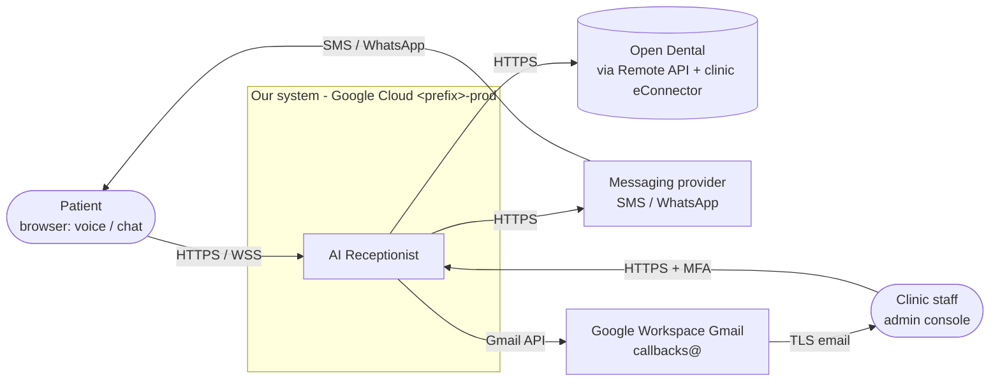
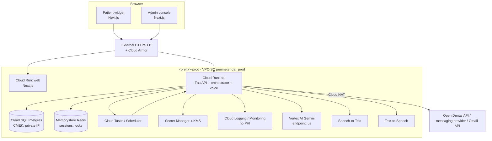
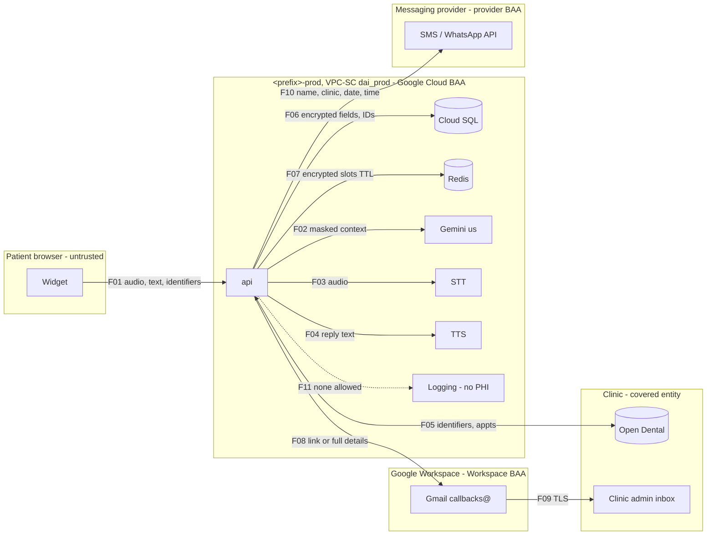
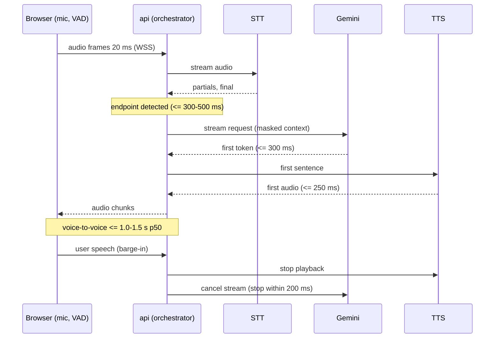

# P0-14: Architecture doc + PHI data-flow diagram

## 1. Summary
Write the final MVP architecture in `docs/architecture/`:
- **Diagrams in three levels:** context, containers, and the PHI data flow with trust boundaries.
- **A network map.**
- **Four sequence diagrams:** a voice turn, booking, callback, and reminder.
- **The PHI flow table:** every hop of PHI, with the exact fields, the vendor (`vendors.yaml` id) and the BAA that covers it. This table becomes the single source of truth and replaces P0-11's interim flow list.
- **ADRs 0002–0006:**
  - 0002 Cloud Run vs GKE;
  - 0003 Pipecat yes/no;
  - 0004 audio transport;
  - 0005 database;
  - 0006 code conventions.

  ADR 0001, the Gemini models, comes from P0-13.

Done means:
- the docs and Mermaid diagrams are merged;
- every PHI edge names its BAA;
- the ADRs are accepted (0003 stays Proposed until P3-01);
- P0-11 is updated to point to the new flow table;
- the P1 and P3 owners are notified.

## 2. Why this matters
Every developer from P1 on needs the same answers:
- Where does this code run?
- What can it reach?
- Which PHI may it send where?

Without one agreed picture, people make conflicting choices: a WebSocket on a platform that cuts it at 5 minutes, a library that calls Gemini with an AI Studio key, a debug path that sends transcripts to an unlisted vendor.

The data-flow diagram is also compliance evidence:
- the risk assessment (P0-11) needs it to be accurate;
- the HIPAA readiness review (P5-14) checks that every PHI hop has a BAA;
- the proposed HIPAA Security Rule update would require a network map (P0-11 §3; Verify).

Plan references: §3 (architecture, stack, BAA strategy), §4.1–4.9 (design decisions), §4.4 (latency targets), §5 (data model), §6 (security plan), §8 Phase 0 ("architecture doc, data-flow diagram showing PHI boundaries").

## 3. Background you need
- **Project in one paragraph:** We are building an MVP of a web-based AI receptionist for US dental clinics. Patients talk (voice) or type (chat) on the clinic's website. The AI identifies or registers them in **Open Dental** (the clinic's practice-management system and our source of truth), books, reschedules or cancels real appointments, sends WhatsApp confirmations and reminders, and escalates emergencies. When it can't resolve something, it creates a callback case and emails the clinic admin (there is no live transfer). It runs on Google Cloud: Gemini on Vertex AI, Google Speech-to-Text and Text-to-Speech, a Python FastAPI backend on Cloud Run, Cloud SQL Postgres and Redis, with a Next.js frontend. Key rules: the LLM only talks and extracts, while deterministic code decides and acts; we store only Open Dental IDs (PatNum, AptNum), never copies of patient records; no PHI goes to any vendor without a signed BAA; and the system must be HIPAA-ready from day one. Work runs in phases: P0 discovery & compliance → P1 core platform + Open Dental adapter → P2 text chat → P3 voice and P4 WhatsApp + admin console (in parallel) → P5 hardening → P6 pilot. This task belongs to **P0, Discovery & Compliance Foundation**.
- **Inputs (approved specs):**
  - P0-04: states, tools and the PHI slot list in `docs/flows/overview.md`;
  - P0-13: Gemini tiers, the `us` endpoint, no grounding, durable cache off;
  - P0-12: Open Dental Remote API, 1 request/second per clinic;
  - P0-07a / P0-07: messaging content per `messaging_policy.yaml`;
  - P0-08: `link_only` email by default;
  - P0-06: org guardrails, VPC-SC perimeters (`dai_prod` enforced), `allowed_services.yaml`;
  - P0-05: projects `<prefix>-dev`, `-staging`, `-prod`, `-ops`;
  - P0-10: `vendors.yaml` ids;
  - P0-11: asset inventory, flows F1–F9, risks;
  - P0-09: Annex A.
- **Cloud Run facts** (read 2026-11-24, all **Verify** at write time):
  - **WebSockets** are supported with no extra configuration. A WebSocket is a request, so it is cut at the **request timeout: default 5 minutes, maximum 60 minutes**, after which the client is disconnected. Google says clients "should handle reconnecting", and a reconnect may land on a different instance (https://docs.cloud.google.com/run/docs/triggering/websockets).
  - **Session affinity** (cookie based) is **best effort**. It breaks when an instance is terminated or hits its concurrency or CPU limits (https://docs.cloud.google.com/run/docs/configuring/session-affinity).
  - **Billing:** any instance with an open WebSocket is billed as **instance-based billing** (formerly "CPU always allocated"), which requires at least 512 MiB of memory (https://docs.cloud.google.com/run/docs/configuring/billing-settings).
  - **Concurrency:** up to 1,000 concurrent requests per instance.
  - **Direct VPC egress** sends traffic into a VPC without a Serverless VPC Access connector. It allows up to 1 Gbps per instance, and connection setup at startup can take a minute or more (https://docs.cloud.google.com/run/docs/configuring/vpc-direct-vpc). Whether it reaches Cloud SQL private IP and Memorystore: **Verify** in their docs.
  - **VPC Service Controls:** Cloud Run is supported but "additional setup is required". Egress-policy enforcement is only guaranteed through the **restricted VIP** (`restricted.googleapis.com`) (https://docs.cloud.google.com/vpc-service-controls/docs/supported-products).
  - **Load balancer:** an external Application Load Balancer with a serverless NEG can front Cloud Run, with Cloud Armor policies. Ingress must be set to **"Internal and Cloud Load Balancing"**, or users can bypass the load balancer through the default `run.app` URL (https://docs.cloud.google.com/load-balancing/docs/https/setting-up-https-serverless).
- **Pipecat facts** (https://github.com/pipecat-ai/pipecat, https://docs.pipecat.ai; **Verify**):
  - an open-source (BSD-2) Python framework for real-time voice agents, maintained by Daily, for Python 3.11–3.14;
  - transports include FastAPI WebSocket, WebSocket server and WebRTC (Daily, LiveKit, SmallWebRTC);
  - Silero VAD (`SileroVADAnalyzer`, 8 or 16 kHz only);
  - Google services:
    - `GoogleSTTService` (Cloud Speech-to-Text V2, service-account credentials);
    - `GoogleTTSService` (Cloud TTS streaming);
    - `GoogleLLMService`, documented with a **Google AI API key** (`GOOGLE_API_KEY`), with no Vertex AI mention found;
    - `GeminiSTTService` and the GenAI backend of `GeminiTTSService`, which also use **API keys**.

  **API-key (AI Studio) paths are forbidden for us** (plan §3.3, DECISIONS #65, P0-06 denies the Gemini Developer API).
- **Mermaid:** a text diagram language that GitHub renders inside Markdown (already used in P0-04).

## 4. Scope
**In scope**
- `docs/architecture/` files (§6) and their Mermaid diagrams.
- The PHI flow table (single source of truth) and the trust-boundary diagram.
- The network map (projects, VPC, subnets, ingress, egress, private services, perimeters).
- Four sequence diagrams with the latency budget.
- Component responsibilities: what each backend module owns, mapped to the repo layout and tasks.
- ADRs 0002–0006 using the ADR template; the ADR index.
- Updating P0-11's flow section to link to the new table, and listing new risks found.

**Out of scope** (and which task covers it)
- Gemini model choice → P0-13 (ADR 0001)
- Terraform for any of this → P1-02, P1-03, P1-04, P1-05
- Final Pipecat decision and the latency prototype → P3-01 (ADR 0003 is updated there)
- Detailed data model and migrations → P1-09
- The repo skeleton and linters → P1-01 (follows ADR 0006)
- Logging/monitoring design → P1-07

## 5. Dependencies and how to start without them
| Depends on | What you need from it | How to work before it is done |
|---|---|---|
| P0-04 Flow designs (approved spec) | PHI slot list per state, tools | Use the slot list in the P0-04 spec (§6 and §9). |
| P0-13 Gemini models (approved spec) | Endpoint, tiers, data settings | Use the Proposed values in DECISIONS #65–68; update if the spike changes them. |
| P0-07 / P0-07a (approved specs, soft) | Messaging vendor and content | Draw the edge to `messaging-provider` with the P0-07a allowed fields; rename the vendor when chosen. |
| P0-11 Risk assessment (approved spec, soft) | Asset inventory, F1–F9 | Start from them; the new table replaces F1–F9. |

## 6. Interface contract

### Files
| Path | Content |
|---|---|
| `docs/architecture/README.md` | Overview, reading order, glossary links, change rules |
| `docs/architecture/context.md` | Level 1: actors and external systems (Mermaid) |
| `docs/architecture/containers.md` | Level 2: deployables, data stores, Google services; component responsibilities table |
| `docs/architecture/phi-flows.md` | PHI trust-boundary diagram + **PHI flow table** (single source of truth) |
| `docs/architecture/network.md` | Network map + resource list |
| `docs/architecture/sequences.md` | Four sequence diagrams + latency budget |
| `docs/adr/README.md` | ADR index and template |
| `docs/adr/0002-runtime-cloud-run.md` … `0006-code-conventions.md` | ADRs |

### Level 1: context (`context.md`)

### Level 2: containers (`containers.md`)

Proposed: **two Cloud Run services**:
- `web` serves the Next.js widget and console;
- `api` serves REST, WebSocket and the Cloud Tasks handlers.

Cloud Tasks call `api` on internal paths with OIDC tokens. A separate `worker` service is added only if P1-06 or P5-06 shows a need.

**Component responsibilities** (table in `containers.md`; maps to the CLAUDE.md repo layout):
| Module (`backend/app/…`) | Owns | Tasks |
|---|---|---|
| `api/` | HTTP and WebSocket routes, session handshake | P1-08, P2-25, P3-02 |
| `orchestrator/` | State machine, slot memory, model router, tool gateway | P2-01, P2-02, P2-06, P2-08, P2-09 |
| `tools/` | The §4.2 backend tools | P1-22, P1-23, P1-24 |
| `domain/` | Patients, scheduling, callbacks, reminders, clinic config | P1-19 to P1-21, P2-13 to P2-24, P4-04 |
| `integrations/` | `open_dental/`, `vertex_ai/`, `speech/`, `messaging/`, `email/` | P1-15 to P1-18, P2-03, P3-03, P3-05, P4-01, P2-23 |
| `core/` | Config, PHI-redacting logging, security, audit | P1-08, P1-10 to P1-14 |

### PHI data flow (`phi-flows.md`)
Trust-boundary diagram. Boundaries: the patient's browser, our prod project inside the VPC-SC perimeter (covered by the Google Cloud BAA), the Google Workspace tenant (Workspace BAA), external vendors (each with its own BAA), and the clinic (covered entity).

**PHI flow table.** This is the source of truth. P0-11 and P0-09 Annex A must match it.
| ID | From → To | PHI fields | Purpose | Vendor id (`vendors.yaml`) | BAA | Protection | Owner tasks |
|---|---|---|---|---|---|---|---|
| F01 | Widget → `api` | Voice audio, chat text, name, DOB, phone, email, address, ZIP, reason text | Conversation | — (our system) | — | TLS 1.2+ via LB; session token; no PHI in URLs | P2-25, P3-02, P1-14 |
| F02 | `api` → Gemini (`us`) | Compact context: state, slots **masked where possible**, last turns | Extraction, replies | `google-cloud` | Google Cloud BAA | Restricted VIP inside VPC-SC; GA models; no grounding; durable cache off | P2-03, P2-04, P0-13 |
| F03 | `api` → STT | Audio stream | Transcription | `google-cloud` | Google Cloud BAA | Same; data logging off | P3-03, P0-06 |
| F04 | `api` → TTS | Reply text (may contain name, date, time) | Speech | `google-cloud` | Google Cloud BAA | Same | P3-05 |
| F05 | `api` ↔ Open Dental | Search identifiers; patient and appointment records returned | Identify, register, book | `open-dental` | Clinic BAA (relay: under review) | TLS; Cloud NAT egress; keys in Secret Manager; 1 req/s per clinic | P1-15 to P1-18, P0-12 |
| F06 | `api` → Cloud SQL | PatNum, AptNum; encrypted: phone, messaging number, callback contact, summaries; consents | Store references and cases | `google-cloud` | Google Cloud BAA | Private IP, CMEK, field encryption | P1-03, P1-09, P1-10 |
| F07 | `api` → Redis | Session slots (encrypted), last N turns | Session state | `google-cloud` | Google Cloud BAA | Private IP, TTL, field encryption; **Verify** Memorystore CMEK/in-transit encryption | P1-04, P2-02 |
| F08 | `api` → Gmail API | `link_only`: urgency, time, case ID (no PHI); `full_details`: plan §4.9 template | Callback notice | `google-workspace` | Workspace BAA | Keyless delegation `gmail.send`; subject never contains PHI | P2-23, P0-08 |
| F09 | Gmail → clinic inbox | As F08 | Callback notice | `google-workspace` | Workspace BAA | TLS compliance rule (non-TLS bounces) | P0-08 |
| F10 | `api` → messaging provider → patient | First name, clinic name, date, time (per `messaging_policy.yaml`) | Confirmation, reminder | `messaging-provider` | Provider BAA | Consent required; opt-out; minimal content | P4-01, P4-03, P4-04, P0-07a |
| F11 | `api` → Cloud Logging | **None allowed** (IDs, state names, timings only) | Operations | `google-cloud` | Google Cloud BAA | PHI-redacting logger; scans | P1-11, P5-08 |
| F12 | Console ↔ `api` | Callback cases, activity log (role-filtered) | Staff work | — | — | MFA, RBAC, audit | P1-13, P4-09, P4-14 |
| F13 | Cloud Tasks → `api` | AptNum, reminder ID only (**no PHI in task payloads**, Proposed) | Reminder and email jobs | `google-cloud` | Google Cloud BAA | OIDC-authenticated internal route | P4-04, P2-23 |
| F14 | Backups / snapshots | Same as F06 | Recovery | `google-cloud` | Google Cloud BAA | CMEK, US location | P1-03, P5-13 |

**Rules:**
- **R-A:** every PHI edge names a vendor id whose `vendors.yaml` row has `phi: yes` or `conditional` and a BAA status.
- **R-B:** a new PHI edge, or a new field on an edge, needs a PR that updates this table, `vendors.yaml` if a vendor is added, and P0-09 Annex A, reviewed by the compliance owner (P0-10 CODEOWNERS covers `docs/architecture/phi-flows.md`; add the path).
- **R-C:** dev and staging have the same flows with **synthetic data only**. The Open Dental edge there goes to test DB (B) (P0-12).

### Network map (`network.md`; Proposed, P1-02 implements)
| Element | Proposed setting |
|---|---|
| VPC per project | `vpc-main`, one subnet per region (`us-central1`), Private Google Access on |
| Ingress | External Application Load Balancer, serverless NEGs for `web` and `api`; Cloud Armor policy (rate limiting, bot protection P2-29); managed certificate; Cloud Run ingress = **Internal and Cloud Load Balancing** |
| Egress from Cloud Run | Direct VPC egress (**Verify** vs connector for Cloud NAT cold-start advice); all traffic routed to VPC |
| Google APIs | DNS for `*.googleapis.com` → `restricted.googleapis.com` VIP (VPC-SC); Vertex AI multi-region host `aiplatform.us.rep.googleapis.com` (**Verify** restricted-VIP support for regional/multi-region endpoints) |
| Cloud SQL | Private IP only (Private Service Access), no public IP, IAM DB auth (**Verify** for the chosen setup) |
| Memorystore | Private IP, AUTH + in-transit encryption (**Verify**) |
| Internet egress | Cloud NAT with static IPs; allowed destinations: `api.opendental.com`, the messaging provider API, `gmail.googleapis.com` (via restricted VIP). Proposed: egress firewall allow-list by FQDN where supported (**Verify**) |
| Perimeter | `dai_prod` enforced (P0-06); ingress/egress rules only for CI deploy from `ops` (P1-06) |
| Admin access | No SSH/RDP into prod; test DB VM in dev via IAP only (P0-12) |

### Sequences (`sequences.md`)
**S1: Voice turn, with the latency budget from plan §4.4.**

**S2: Booking** (plan §4.6):
1. confirm with the patient;
2. Redis lock on the slot;
3. re-query Open Dental;
4. create the appointment with an idempotency key;
5. verify the created record;
6. release the lock;
7. confirm to the patient.

The diagram shows the 1 request/second Open Dental throttle and the filler phrase while waiting.

**S3: Callback:**
1. collect and read back;
2. insert `callback_requests`;
3. enqueue the email task;
4. send through the Gmail API;
5. mark `email_status`;
6. raise an unsent alert after the retries fail.

**S4: Reminder:**
1. schedule at appointment − 60 min;
2. the task fires;
3. re-fetch the appointment from Open Dental;
4. check consent and opt-out;
5. send, or cancel/reschedule the job.

### ADRs (`docs/adr/`)
**Template:** Title · Status (Proposed / Accepted / Superseded by NNNN) · Date · Context · Options considered · Decision · Consequences · Review triggers.

| ADR | Decision (Proposed) | Key reasons and conditions |
|---|---|---|
| 0002 Runtime: Cloud Run vs GKE | **Cloud Run** for `web` and `api` | Managed, scales to need, supports WebSockets and VPC-SC. Settings for `api`: request timeout 3600 s; instance-based billing; session affinity on (best effort only); min instances ≥ 1 in prod; concurrency tuned in P5-06. **Consequence:** sessions must survive reconnects, because the WebSocket is cut at 60 min or on instance loss: session state is in Redis (P2-02), and the client reconnects with its session token (P3-02). GKE is reconsidered only if P3-01/P5-06 show that Cloud Run can't meet latency or concurrency. |
| 0003 Pipecat | **Proposed: use Pipecat for the voice pipeline** (transport, Silero VAD, STT/TTS streaming, barge-in), **not** for the conversation logic or the LLM call | Our state machine, tool gateway and router stay in `orchestrator/`. The LLM call goes through our P2-03 Vertex AI provider (a custom Pipecat processor or a call-out), **never** Pipecat's `GoogleLLMService` with an API key, nor `GeminiSTTService` or the GenAI backend of `GeminiTTSService`. Only `GoogleSTTService` / `GoogleTTSService` with service-account credentials (**Verify** they can target US endpoints and that data logging stays off). Final decision in P3-01 after the latency prototype; status stays Proposed until then. |
| 0004 Audio transport | **WebSocket** (`wss://`, 16 kHz PCM frames, 20 ms) through the LB to `api` | Works with Cloud Run and the LB without TURN/SFU infrastructure; the browser does echo cancellation. WebRTC (e.g. SmallWebRTC) is reconsidered in P3-01 if network jitter hurts latency. |
| 0005 Database | **Cloud SQL for PostgreSQL** (CMEK, private IP, HA in prod) | Small relational data (plan §5); simpler and cheaper than AlloyDB; covered by the BAA (P0-06 list). |
| 0006 Code conventions | Adopt the CLAUDE.md conventions as **Accepted**: repo layout, Python 3.12/FastAPI/Pydantic v2/SQLAlchemy 2 async, `ruff` + `mypy`, typed exceptions, UTC storage, E.164, ISO DOB, config via env vars + Secret Manager | One set of rules for P1-01 to enforce. |

## 7. Implementation guide
1. **Collect inputs:**
   - the P0-04 PHI slot list;
   - the P0-13 ADR draft;
   - P0-12 notes;
   - `messaging_policy.yaml`;
   - P0-08 email modes;
   - P0-06 perimeters and allowed APIs;
   - P0-11 inventory and F1–F9;
   - `vendors.yaml`.
2. **Write `context.md` and `containers.md`** with the diagrams in §6 and the responsibilities table. Every Google service in the diagram must be in `allowed_services.yaml`.
3. **Write `phi-flows.md`:**
   - cross-check each P0-04 PHI slot: it must appear in at least one flow row, with the exact field;
   - cross-check each vendor with `phi: yes` or `conditional`: it must appear in at least one row;
   - mark anything uncertain **Verify**.
4. **Write `network.md`** from §6. Check each "Verify" item in the Google docs and record the answer with its URL. Open items go to P1-02 as questions.
5. **Write `sequences.md`** (S1–S4). The latency notes in S1 come from plan §4.4 and P0-13's measured first-token numbers.
6. **Write ADRs 0002–0006** with the template. For 0003:
   - check the current Pipecat docs for a Vertex AI option and for the Google STT/TTS location settings;
   - record the result.
7. **Review:**
   - the tech lead and one backend engineer review all files;
   - the compliance owner reviews `phi-flows.md` and `network.md`;
   - accept ADRs 0002, 0004, 0005 and 0006; 0003 stays Proposed.
8. **Update P0-11 (risk assessment):**
   - replace its flow section with a link to `phi-flows.md`;
   - add risks found here, e.g. WebSocket reconnect losing turns, or a Pipecat API-key misuse.

   Bump the assessment's version note.
9. **Add `docs/architecture/phi-flows.md` to CODEOWNERS** (P0-10 `compliance-owners`).
10. **Notify:**
    - P1-01 (ADR 0006, layout);
    - P1-02 (network map, ingress, NAT, restricted VIP, open Verify items);
    - P1-03 / P1-04 (private IP, CMEK, Redis settings);
    - P1-06 (perimeter ingress for deploys, two services);
    - P2-02 (session state must survive reconnects);
    - P2-03 (no Pipecat LLM API-key path);
    - P3-01 / P3-02 (ADRs 0003, 0004; reconnect requirement);
    - P4-04 (no PHI in task payloads);
    - P0-09 (Annex A must match the flow table);
    - P0-10 (vendor ids used).

## 8. Edge cases and error handling
| Situation | Expected behaviour |
|---|---|
| A PHI slot from P0-04 has no flow row | Add the row before merging; the reviewer rejects otherwise. |
| A flow needs a vendor not in `vendors.yaml` | Stop: add it via P0-10 (pending BAA) first; the flow is marked "blocked until BAA". |
| Pipecat has no Vertex AI LLM service | Expected: we call Gemini through our own P2-03 provider from a custom processor. Never set `GOOGLE_API_KEY`. |
| Pipecat's Google STT/TTS can't target a US endpoint or set our options | Use our own STT/TTS integrations (P3-03, P3-05) and keep Pipecat for transport/VAD only, or drop it (P3-01 decides). |
| The voice session is longer than 60 minutes, or an instance dies | The client reconnects with its session token; the orchestrator restores state from Redis; the user hears at most a short pause. P3-02 tests this. |
| Direct VPC egress + Cloud NAT has cold-start delays | Use a Serverless VPC Access connector for egress (Google's advice for Cloud NAT), and record it in ADR 0002. |
| The restricted VIP doesn't serve the Vertex AI `us` multi-region host | Use a US regional endpoint that it serves (P0-13 allows `us-*`), and record it. Never route PHI around the perimeter. |
| Someone wants Cloud Tasks payloads to carry patient names "to save a lookup" | Not allowed (F13): payloads carry IDs; the handler re-fetches. |
| A diagram and the table disagree | The table wins; fix the diagram in the same PR. |

## 9. Security, HIPAA and PHI
- **No PHI is handled in this task.** It documents where PHI will flow.
- **The PHI flow table is compliance evidence.** Changes need compliance-owner review (CODEOWNERS), and each PHI edge must map to a signed BAA before real data flows (the PHI gate, DECISIONS #25, checked by P0-10's `--gate`).
- **Key rules recorded here:**
  - no PHI in URLs, logs or task payloads;
  - masked context to Gemini where possible;
  - no API-key paths to Gemini (including through Pipecat);
  - load-balancer-only ingress;
  - restricted VIP for Google APIs.
- **Audit:** git history of `docs/architecture/` and `docs/adr/`.

## 10. Testing
No application code. The reviewer checks and records in the PR:
- Every PHI slot in `docs/flows/overview.md` (P0-04) appears in `phi-flows.md`.
- Every vendor in `vendors.yaml` with `phi: yes` or `conditional` appears in at least one flow; every flow's vendor id exists in `vendors.yaml`.
- Every Google service in the diagrams is in `allowed_services.yaml`.
- The diagrams render on GitHub (Mermaid preview) and in `tools/build_pdf.py` output as code if not rendered.
- Every "Verify" in `network.md` is either answered with a URL or listed as an open question for P1-02.

## 11. Acceptance criteria
- [ ] `docs/architecture/` (README, context, containers, phi-flows, network, sequences) is merged with rendered Mermaid diagrams
- [ ] The PHI flow table lists every PHI hop with fields, vendor id, BAA and protection; every P0-04 PHI slot and every PHI vendor is covered
- [ ] The trust-boundary diagram marks every PHI hop with its BAA
- [ ] ADRs 0002, 0004, 0005, 0006 are Accepted; 0003 is Proposed with its conditions; the ADR index lists 0001–0006
- [ ] P0-11's flow section links to `phi-flows.md`, and new risks are added
- [ ] `phi-flows.md` is in CODEOWNERS for `compliance-owners`
- [ ] The P1-01, P1-02, P1-03, P1-04, P1-06, P2-02, P2-03, P3-01, P3-02, P4-04, P0-09 and P0-10 issues are notified

## 12. Definition of done
- [ ] All acceptance criteria met
- [ ] Tests added and passing in CI: not applicable (docs); the §10 checks are recorded in the PR
- [ ] PR reviewed (HIPAA review if labelled `phi`): tech lead + compliance owner; no `phi` label (no PHI handled)
- [ ] No PHI in logs: not applicable
- [ ] Docs / README updated: `docs/architecture/README.md`, `docs/adr/README.md`

## 13. Hand-off
| Task | Can rely on |
|---|---|
| P1-01 Monorepo | ADR 0006 conventions; module responsibilities |
| P1-02 Terraform base | Network map, ingress via LB + Cloud Armor, Cloud Run settings, NAT, restricted VIP, open Verify items |
| P1-03 / P1-04 | Private IP, CMEK, HA, Redis settings |
| P1-06 CI/CD | Two Cloud Run services; deploy path into the perimeter from `ops` |
| P2-02 Slot memory | Session state must be fully restorable after a reconnect |
| P2-03 LLM provider | F02 rules; no API-key path; Pipecat boundary |
| P3-01 / P3-02 | ADRs 0003 and 0004 to confirm; reconnect and 60-minute limit |
| P4-04 Reminders | F13: IDs only in task payloads |
| P0-09 / P0-11 / P5-14 | The PHI flow table as the source for Annex A, the risk assessment and the readiness review |

## 14. Open questions
| Question | Owner | Needed by |
|---|---|---|
| Does the restricted VIP serve the Vertex AI `us` multi-region host (`aiplatform.us.rep.googleapis.com`)? | Tech lead | Step 4 |
| Direct VPC egress or a Serverless VPC Access connector with Cloud NAT? | Tech lead / P1-02 owner | Step 4 |
| Does Pipecat offer a Vertex AI path, and can its Google STT/TTS services set US endpoints? | Tech lead, confirmed in P3-01 | Step 6 |
| One `api` service for REST, WebSocket and task handlers, or a separate `voice` service? | Tech lead | Step 2 |

## 15. References
- Plan §3, §4.1–4.9, §4.4, §5, §6, §8 Phase 0
- Cloud Run WebSockets: https://docs.cloud.google.com/run/docs/triggering/websockets
- Request timeout: https://docs.cloud.google.com/run/docs/configuring/request-timeout
- Session affinity: https://docs.cloud.google.com/run/docs/configuring/session-affinity
- Billing settings: https://docs.cloud.google.com/run/docs/configuring/billing-settings
- Direct VPC egress: https://docs.cloud.google.com/run/docs/configuring/vpc-direct-vpc
- Cloud Run ingress: https://docs.cloud.google.com/run/docs/securing/ingress
- Serverless NEG + external LB: https://docs.cloud.google.com/load-balancing/docs/https/setting-up-https-serverless
- VPC-SC supported products: https://docs.cloud.google.com/vpc-service-controls/docs/supported-products
- Pipecat: https://github.com/pipecat-ai/pipecat, https://docs.pipecat.ai
- Mermaid: https://mermaid.js.org
- Related tasks: P0-04, P0-05, P0-06, P0-07, P0-07a, P0-08, P0-09, P0-10, P0-11, P0-12, P0-13, P1-01 to P1-14, P2-02, P2-03, P2-04, P2-23, P2-25, P3-01, P3-02, P3-03, P3-05, P4-01, P4-04, P5-06, P5-08, P5-13, P5-14
