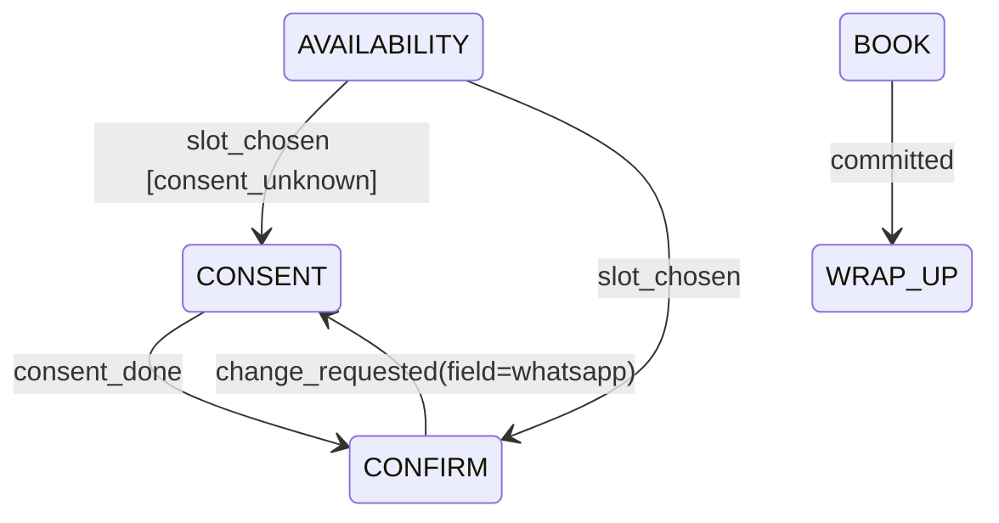

# P4-02: WhatsApp consent and number capture in the conversation, consent storage and staff consent screen

> Consolidated task (#51). It absorbs P4-16 "Consent / opt-out management screen" (see `tasks/_CONSOLIDATION.md`). Seed dependency P1-09 was merged into P1-03.

## 1. Summary
Before a patient confirms a booking or reschedule, the AI asks whether they want their confirmation and a 1-hour reminder on WhatsApp. If they say yes, it gets the WhatsApp number:
- it first offers the phone number they already gave ("Is your WhatsApp number the one ending in 0123?");
- if they say no, it asks for a new number.

The consent is stored right away, together with the number and the exact wording version shown. Then the confirmation card shows the row **"WhatsApp confirmation will be sent to: +1 (503) 555-0123"** with "Please check this number carefully", so the patient checks the number before saying yes (DECISIONS #254).

This task also builds:
- the shared `ConsentService` (grant, revoke, current state), which P4-01's STOP/START handling also uses;
- the `record_consent` tool handler and the `consent_unknown` guard;
- a staff screen in the admin console to look up, revoke and (with a reason) grant consent. Every change is audited.

The task is done when:
- no message can be sent without a consent record (P4-01 gate G7 reads what this task writes);
- every consent row carries a timestamp, channel, wording version and source;
- the card shows the number;
- every staff change is audited.

## 2. Why this matters
Plan §4.7 says WhatsApp messages are sent "if consented", and that after booking we store "a consent record (timestamp, channel, wording shown)". Meta's policy also requires opt-in before a business messages a person on WhatsApp (§3).

Without this task, P4-01 will never send anything: gate G7 returns `NO_CONSENT`. Worse, a careless shortcut could message people who never agreed.

A wrong WhatsApp number is the main way an appointment message reaches the wrong person (P0-11 risk R09). The user asked that the number be shown on the confirmation card with a "check carefully" note, so the consent question must come **before** the card, not after the booking as P0-04 first proposed (DECISIONS #256).

The staff screen (from P4-16) covers what happens outside the chat. A patient may call and say "stop texting me" or "please send me reminders". Staff need a safe, audited way to record that.

## 3. Background you need
- **Project in one paragraph:** We are building an MVP of a web-based AI receptionist for US dental clinics. Patients talk (voice) or type (chat) on the clinic's website. The AI identifies or registers them in **Open Dental** (the clinic's practice-management system and our source of truth), books, reschedules or cancels real appointments, sends WhatsApp confirmations and reminders, and escalates emergencies. When it can't resolve something, it creates a callback case and emails the clinic admin (there is no live transfer). It runs on Google Cloud: Gemini on Vertex AI, Google Speech-to-Text and Text-to-Speech, a Python FastAPI backend on Cloud Run, Cloud SQL Postgres and Redis, with a Next.js frontend. Key rules: the LLM only talks and extracts, while deterministic code decides and acts; we store only Open Dental IDs (PatNum, AptNum), never copies of patient records; no PHI goes to any vendor without a signed BAA; and the system must be HIPAA-ready from day one. Work runs in phases: P0 discovery & compliance → P1 core platform + Open Dental adapter → P2 text chat → P3 voice and P4 WhatsApp + admin console (in parallel) → P5 hardening → P6 pilot. This task belongs to **P4, WhatsApp, Reminders & Admin Console**.
- **Meta's opt-in rules** (https://developers.facebook.com/documentation/business-messaging/whatsapp/getting-opt-in, updated Jun 16, 2026): businesses "are required to obtain opt-in before messaging people on WhatsApp". The person must have given their mobile number, and the business "must clearly state that a person is opting in to receive communication from the business" and "must clearly state the business's name". A website is a supported opt-in method. Meta also advises telling people how to opt out, and opting in by message category. Our consent text names the clinic, the message types (confirmation and a reminder) and how to stop (reply STOP).
- **Why the wording mentions Meta:** Meta states the WhatsApp Business Platform "is not HIPAA compliant" (DECISIONS #35). If P0-07a sets `consent.risk_notice_required: true`, the advisor-approved risk sentence is part of the consent text. The proposed text below already includes a plain one.
- **Content modes (P4-01):**
  - `phi_free_nudge`: messages carry only the clinic name and phone;
  - `minimal_phi`: adds first name, date and time.

  The consent text must describe what the messages contain, so there is **one wording version per mode**.
- **Tables (P1-03):**
  - `contact_prefs` has one row per (clinic, PatNum): channel, encrypted number and blind index;
  - `consents` is an append-only history. Its sources are `CHAT`, `VOICE`, `STAFF`, `SMS_STOP`, `SMS_START`, plus `WHATSAPP_STOP` and `WHATSAPP_START` (P4-01);
  - `current_consents` is the latest row per (clinic, address blind index, channel, purpose).

  Consent is **per number**, so in a household where several patients share one number, one consent covers that number.
- **State machine (P2-01, P0-04):**
  - states have handlers (`on_enter`, `on_turn`) that return events, a reply intent and tool calls;
  - guards are registered by name;
  - tapped choices arrive as `choice_id` and map to slots and events without an LLM call (P2-16, DECISIONS #193).
- **Tool gateway (P2-08):** every write goes through a tool with preconditions and idempotency keys. `record_consent` already has a contract and stub in P1-22; this task writes the real handler.
- **Voice read-back (P3-09):** in voice, numbers the patient says are read back digit by digit before use. `whatsapp_number` is in `READBACK_SLOTS` (DECISIONS #254).

New glossary terms: consent wording version, `ConsentService`, consent step, WhatsApp card row.

## 4. Scope
**In scope**
- **Flow change** (additive to P0-04, P2-16, P2-18): the `CONSENT` state moves to between `AVAILABILITY` and `CONFIRM` (book and reschedule). `BOOK → CONSENT` is removed (§6.1).
- **`ConsentHandler`** (the `CONSENT` state): sub-steps for the consent question, the number question and saving, with templates and choices.
- **Guard `consent_unknown`** (renamed in meaning to "consent step needed"; the name is kept).
- **`record_consent` tool handler** (P1-22 contract, extended with `address_source`).
- **`ConsentService`** in `backend/app/domain/messaging/consent.py`: `current()`, `grant()`, `revoke()`, `history()`. P4-01's STOP/START also uses it.
- **WhatsApp card row** for book, reschedule and cancel cards (`messaging_card_row()`), including the spoken version.
- **Consent wording** `docs/messaging/consent_texts.yaml`, one version per content mode, plus the staff phone script.
- **Staff API** `/v1/admin/consents/*` and the admin page `consents` (search, history, revoke, grant with a reason).
- **DB:** column `consents.staff_reason` (additive to P1-03).
- **Permissions:** `CONSENT_READ`, `CONSENT_WRITE` (additive to P1-13).

**Out of scope** (and which task covers it)
- Sending messages, STOP/START keywords, delivery tracking → P4-01
- Sending the confirmation after booking → P4-03
- Reminders → P4-04
- Admin console shell, login, navigation → P4-09 (this task adds one page to it)
- Editing the consent wording in the admin console → not in the MVP (wording changes go through review and a new version in the YAML file)
- SMS consent → not built (DECISIONS #252)

## 5. Dependencies and how to start without them
| Depends on | What you need from it | How to work before it is done |
|---|---|---|
| P4-01 Messaging (approved spec) | Policy access (`PolicyStore`: `whatsapp.allowed`, `mode`); P4-01 calls `ConsentService` for STOP/START | Read the policy file directly with the P4-01 loader; use `messaging_policy.test.yaml`. |
| P0-07a / P0-15 (approved specs) | Risk-notice requirement; approved wording | Use the proposed texts in §6.4; the advisor confirms them before production. |
| P1-03 DB (approved spec) | `contact_prefs`, `consents`, `current_consents`, encryption and blind-index helpers | Use the P1-03 test fixtures; add the `staff_reason` migration here. |
| P1-22 Tools (approved spec) | `record_consent` contract and stub | Replace the stub; keep the contract plus the additive field. |
| P2-01 / P2-08 (approved specs) | `StateHandler`, `GuardRegistry`, `ToolCallRequest`, gateway, idempotency | Unit-test the handler with the P2-01 test harness (`FlowTestDriver`). |
| P2-04 / P2-16 / P2-18 (approved specs) | Templates, choices, `ConfirmationCard`, `CardRow` | Add the templates and the card row as additive edits. |
| P3-09 (approved spec) | Voice read-back of `whatsapp_number` | Text-only tests first; voice tests use the P3-09 harness. |
| P1-13 Staff auth (approved spec) | `require_permission()` | Add the two permissions. |
| P4-09 Admin shell (not yet written) | Layout, navigation, API client, auth | Build the page as a standalone route with the P1-13 session cookie and mock data; mount it in the shell when P4-09 lands. |

## 6. Interface contract

### 6.1 Flow change (P0-04 flow file, additive)

- Guarded transitions are tried first (P2-01 rule), so `slot_chosen` goes to `CONSENT` only when the guard is true.
- The old `BOOK → CONSENT: committed [consent_unknown]` and `CONSENT → WRAP_UP` are removed.
- Cancel doesn't pass through `CONSENT` (there's nothing new to agree to). Its card shows the WhatsApp row only if consent is already granted.
- `CONSENT` allowed tools: `record_consent` only. Collects: `consent_whatsapp`, `whatsapp_number`.
- New events: `consent_done`, and `change_requested` with target `whatsapp`.

### 6.2 Guard `consent_unknown`
```python
async def consent_unknown(g: GuardContext) -> bool:
    """True when the consent step must run for the active patient."""
    policy = policy_store.current()
    if not policy.channel_allowed("whatsapp"):
        return False                                    # never ask when the channel is off
    st = g.state
    if g.slots.active_patient_key() in st.consent_handled:   # asked (yes or no) for this patient in this chat
        return False
    addr = await consent_service.address_for(g.config.clinic_id, g.principal.active_patnum, Channel.WHATSAPP)
    if addr and (await consent_service.current(g.config.clinic_id, addr.bidx, Channel.WHATSAPP)).granted:
        return False                                    # already granted for the number on file
    if addr is None and st.household_consent_bidx is not None:   # parent already consented in this chat
        return False                                    # handler links the child to that number (§6.3 step 0)
    return True
```
New `ConversationState` fields (additive to P2-01):
- `consent_handled: list[str]`: patient keys, max 4, per DECISIONS #185;
- `household_consent_bidx: str | None`: hex of the bidx granted in this chat.

### 6.3 `ConsentHandler` (`backend/app/orchestrator/flows/consent.py`)
Sub-step is kept in `ConversationState.consent_step`: `ask | number_check | number_ask | saving`.

0. **On enter, household shortcut:** if `household_consent_bidx` is set and the active patient has no `contact_prefs` row, call `record_consent(address_source="household")`. This links the child to the parent's consented number. Then `consent_done`. There's no question; the card row shows the number.
1. **`ask`** → reply intent `consent_ask` with choices `consent:yes` "Yes, send on WhatsApp" and `consent:no` "No thanks". The chunk carries the full consent text (§6.4) as the message text; in voice it also goes into the chat window.
2. **On turn in `ask`:**
   - `consent_whatsapp=yes` (or `consent:yes`) → go to `number_check` if the session has a `mobile_phone` or `phone` slot, otherwise `number_ask`;
   - `no` → add the patient to `consent_handled`, reply `consent_declined_ok`, `consent_done`;
   - not understood twice → treat as no (`consent_declined_ok`).
3. **`number_check`** → reply `consent_number_same` with `{last4}` (from the session's slot, never from Open Dental) and choices `wa:same` "Yes, that number" and `wa:other` "A different number".
   - `wa:same` → `address_source = "mobile_phone"` or `"phone"`;
   - `wa:other`, or the patient says a number → `number_ask`, or use the number directly if one was extracted.
4. **`number_ask`** → slot question `whatsapp_number` (P2-04). P2-05 normalizes the answer to E.164 US.
   - Invalid → `whatsapp_number_invalid` ("Sorry, that doesn't look like a US mobile number. Could you type it again?").
   - Two invalid answers → `consent_skip_number` ("No problem, let's skip WhatsApp for now.") → `consent_handled`, `consent_done`.
   - In voice, P3-09 reads the number back before the handler sees it as confirmed.
5. **`saving`** → `ToolCallRequest("record_consent", {...})`.
   - On success: `consent_handled += [patient]`, `household_consent_bidx = bidx`, reply `consent_saved` ("Thanks. I'll send your confirmation to that WhatsApp number."), `consent_done`.
   - On tool error: reply `consent_save_failed` ("I couldn't save that just now, so I'll skip WhatsApp messages for this visit. Our team can turn them on later."), `consent_handled`, `consent_done`. The booking is never blocked by consent.
6. **`change_requested(field=whatsapp)` from `CONFIRM`** → enter at `number_ask` (consent already given in this chat). The new number gets its own `GRANTED` row; the old address's consent is left as is, because it may belong to another family member.

### 6.4 Consent texts (`docs/messaging/consent_texts.yaml`)
```yaml
schema_version: 1
policy_version: "1.0"            # must equal messaging_policy.yaml decision_version (startup check)
texts:
  - id: wa-optin-nudge-v1
    mode: phi_free_nudge
    chat: >-
      Would you like {clinic_name} to send you a booking confirmation and a reminder 1 hour before your visit on WhatsApp?
      WhatsApp is run by Meta, outside our clinic's own systems, so these messages only say that you have an update and give our phone number.
      It's optional and doesn't change your booking. You can reply STOP at any time to turn them off.
    voice: "Would you like a confirmation and a reminder on WhatsApp? I've put the details in the chat window. You can say yes or no."
  - id: wa-optin-minimal-v1
    mode: minimal_phi
    chat: >-
      Would you like {clinic_name} to send you a booking confirmation and a reminder 1 hour before your visit on WhatsApp?
      WhatsApp is run by Meta, outside our clinic's own systems. The messages will include your first name and the date and time of your visit, nothing about the reason for it.
      It's optional and doesn't change your booking. You can reply STOP at any time to turn them off.
    voice: "Would you like a confirmation and a reminder on WhatsApp? I've put the details in the chat window. You can say yes or no."
  - id: staff-optin-v1
    mode: any
    staff_script: >-
      "Would you like {clinic_name} to send your appointment confirmations and a reminder 1 hour before each visit on WhatsApp,
      to the number ending in {last4}? You can reply STOP at any time to turn them off."
```
Rules:
- The handler picks the text whose `mode` equals the policy's `whatsapp.mode`, and stores its `id` as `consents.wording_version`.
- If `risk_notice_required` and the policy has `consent.risk_notice_text`, that sentence replaces the second sentence.
- Startup check C1: exactly one text per mode in use, `policy_version` matches, and the only placeholders are `{clinic_name}` and `{last4}`.
- Any change to the text means a new `id` (old rows keep pointing to the version the patient saw).

### 6.5 Templates (additive to P2-04)
| Intent | Text | Choices |
|---|---|---|
| `consent_ask` | consent text (§6.4, chat or voice) | `consent:yes` "Yes, send on WhatsApp", `consent:no` "No thanks" |
| `consent_number_same` | "Great. Is your WhatsApp number the one ending in {last4}?" | `wa:same` "Yes, that number", `wa:other` "A different number" |
| `whatsapp_number` (slot question, already added) | "What's your WhatsApp number? We'll send your appointment confirmation there." | - |
| `whatsapp_number_invalid` | "Sorry, that doesn't look like a US mobile number. Could you type it again?" | - |
| `consent_skip_number` | "No problem, let's skip WhatsApp for now." | - |
| `consent_saved` | "Thanks. I'll send your confirmation to that WhatsApp number." | - |
| `consent_declined_ok` | "No problem. You won't get WhatsApp messages." | - |
| `consent_save_failed` | "I couldn't save that just now, so I'll skip WhatsApp messages for this visit. Our team can turn them on later." | - |

Choice mapping (P2-16 `choice_id`, no LLM):
- `consent:yes` → `consent_whatsapp=true`
- `consent:no` → `false`
- `wa:same` → `whatsapp_use_on_file=true`
- `wa:other` → `whatsapp_use_on_file=false`

### 6.6 WhatsApp card row (`messaging_card_row`)
```python
async def messaging_card_row(hctx: HandlerContext, kind: Literal["book", "reschedule", "cancel"]) -> CardRow | None:
    """Last row of the book / reschedule / cancel confirmation card (DECISIONS #254). None when no consent."""
# Returns, when the active patient's current WhatsApp consent is GRANTED (including one granted moments ago):
CardRow(label="WhatsApp confirmation will be sent to",
        value="+1 (503) 555-0123",
        field="whatsapp",
        note="Please check this number carefully. If it's wrong, the message will go to someone else.")
```
- P2-16 and P2-18's `CONFIRM` `on_enter` append this row (additive edits).
- `CardRow` gains `field="whatsapp"` and an optional `note: str | None` (additive to P2-04).
- For `cancel`, the label reads "WhatsApp cancellation notice will be sent to".
- Voice: `{spoken_summary}` ends with "We'll send the WhatsApp message to 5-0-3, 5-5-5, 0-1-2-3." (digits grouped as in P2-04).
- The number comes from the session slot if it was just captured; otherwise from `contact_prefs` (decrypted in memory only).
- Patient says "change the WhatsApp number" → P2-27 `change:whatsapp` → `change_requested(field=whatsapp)` → `CONSENT` at `number_ask`.

### 6.7 `record_consent` tool (P1-22 contract, extended)
```python
class RecordConsentInput(BaseModel):
    model_config = ConfigDict(extra="forbid")
    channel: Literal["WHATSAPP"]
    granted: Literal[True]                 # the chat only grants; declining stores nothing (DECISIONS #256)
    template_id: str                       # consent wording version, e.g. "wa-optin-nudge-v1" (must exist in consent_texts.yaml)
    address_source: Literal["whatsapp_number", "mobile_phone", "phone", "household"]   # NEW: where the number comes from

class RecordConsentOutput(BaseModel):
    recorded: bool
    consent_id: uuid.UUID
```
- The number itself is **never** a tool argument. The handler reads it server-side from slot memory (or from `household_consent_bidx` → the parent's `contact_prefs`), so it never passes through the LLM or the tool log.
- Preconditions (P2-08): `verified`, `consent_unknown`.
- Idempotency key (changed, additive to P2-08): `consent:{session_id}:{channel}:{patnum}:{bidx_hex[:16]}`. The old key would collide when two family members or two numbers are handled in one chat.
- Handler steps:
  1. Resolve E.164.
  2. `bidx = blind_index(e164)`; `enc = encrypt(e164)`.
  3. Upsert `contact_prefs(clinic, active_patnum)` with channel `WHATSAPP`, `enc`, `bidx`.
  4. `ConsentService.grant(..., source=CHAT|VOICE by turn channel, wording_version=template_id, session_id)`.
  5. Return.

  Steps 3 and 4 run in one transaction.

### 6.8 ConsentService (`backend/app/domain/messaging/consent.py`)
```python
class ConsentSource(StrEnum):
    CHAT = "CHAT"; VOICE = "VOICE"; STAFF = "STAFF"
    WHATSAPP_STOP = "WHATSAPP_STOP"; WHATSAPP_START = "WHATSAPP_START"
    SMS_STOP = "SMS_STOP"; SMS_START = "SMS_START"

@dataclass(frozen=True)
class ConsentState:
    granted: bool
    action: Literal["GRANTED", "REVOKED"] | None     # None = never recorded
    source: ConsentSource | None
    wording_version: str | None
    occurred_at: datetime | None

class StaffReason(StrEnum):
    PATIENT_REQUEST_PHONE = "PATIENT_REQUEST_PHONE"           # grant or revoke
    PATIENT_REQUEST_IN_PERSON = "PATIENT_REQUEST_IN_PERSON"   # grant or revoke
    SIGNED_FORM = "SIGNED_FORM"                               # grant
    WRONG_NUMBER = "WRONG_NUMBER"                             # revoke
    OTHER_REVOKE = "OTHER_REVOKE"                             # revoke only (never a grant)

class ConsentService:
    async def address_for(self, clinic_id: UUID, patnum: int, channel: Channel) -> AddressRef | None: ...
    async def current(self, clinic_id: UUID, bidx: bytes, channel: Channel) -> ConsentState: ...
    async def grant(self, clinic_id: UUID, *, bidx: bytes, patnum: int | None, channel: Channel,
                    source: ConsentSource, wording_version: str, session_id: UUID | None = None,
                    staff_user_id: UUID | None = None, staff_reason: StaffReason | None = None) -> UUID: ...
    async def revoke(self, clinic_id: UUID, *, bidx: bytes, patnum: int | None, channel: Channel,
                     source: ConsentSource, staff_user_id: UUID | None = None,
                     staff_reason: StaffReason | None = None) -> RevokeResult: ...
        # inserts REVOKED, cancels PENDING/ENQUEUED reminders of every PatNum whose contact_prefs has this bidx
        # (skip_reason NO_CONSENT, Cloud Task deleted best effort), audits consent.revoke; RevokeResult.cancelled_reminders
    async def history(self, clinic_id: UUID, bidx: bytes, channel: Channel, limit: int = 50) -> list[ConsentRow]: ...
```
- `grant` and `revoke` write the `consents` row and the audit event (`consent.grant` / `consent.revoke` with `channel`, `source`, `template_id`, `staff_reason`) in the same transaction.
- A no-op is refused: `grant` when already `GRANTED` returns the existing ID without a new row; `revoke` when not granted likewise.
- P4-01's `InboundHandler` calls `revoke(source=WHATSAPP_STOP)` and `grant(source=WHATSAPP_START, wording_version="wa-start-v1")` (additive note in P4-01).

### 6.9 Staff API (`backend/app/api/admin/consents.py`)
PHI (phone) goes in the request body, never in the URL.
```
POST /v1/admin/consents/search          Permission CONSENT_READ
     {"patnum": 1234}  or  {"phone": "+15035550123"}       (exactly one)
     200 {"items": [{
            "patnum": 1234,                      # contact_prefs rows with this PatNum or this number
            "channel": "WHATSAPP",
            "number_last4": "0123",
            "current": {"action": "GRANTED", "source": "CHAT", "wording_version": "wa-optin-nudge-v1",
                        "occurred_at": "2026-12-08T16:02:11Z"},
            "shared_with_patnums": [1235],       # household: other PatNums on the same number
            "history": [{"action": "GRANTED", "source": "CHAT", "wording_version": "wa-optin-nudge-v1",
                         "staff": null, "staff_reason": null, "occurred_at": "2026-12-08T16:02:11Z"}]
         }]}
     (A number with consent rows but no contact_prefs row, e.g. a STOP from an unknown number,
      is returned with "patnum": null.)
POST /v1/admin/consents/revoke          Permission CONSENT_WRITE
     {"patnum": 1234, "channel": "WHATSAPP",
      "reason": "PATIENT_REQUEST_PHONE" | "PATIENT_REQUEST_IN_PERSON" | "WRONG_NUMBER" | "OTHER_REVOKE"}
     200 {"consent_id": "uuid", "cancelled_reminders": 2}
     404 no contact_prefs for this PatNum · 409 not currently granted
POST /v1/admin/consents/grant           Permission CONSENT_WRITE
     {"patnum": 1234, "channel": "WHATSAPP", "phone": "+15035550123",
      "reason": "PATIENT_REQUEST_PHONE" | "PATIENT_REQUEST_IN_PERSON" | "SIGNED_FORM",
      "script_read": true}
     200 {"consent_id": "uuid"}
     409 channel not allowed by policy · 409 already granted · 422 script_read false or invalid phone
```
- `grant` upserts `contact_prefs` for that PatNum with the number and writes `GRANTED` with source `STAFF`, `wording_version=staff-optin-v1` and the reason.
- Every call is scoped to the staff user's clinic.
- Search, revoke and grant are audited (`consent.search` with no PHI in `details`; `consent.grant` / `consent.revoke`).

### 6.10 Admin page (`frontend/app/admin/consents/page.tsx`; path corrected per P1-01 by P4-09, DECISIONS #262)
- **Search box:** "PatNum or phone number" (the phone is sent in a POST body).
- **Result card per number:** channel, "…0123", status badge (Granted / Revoked / Never asked), "Shared with PatNum 1235" when it applies, and a history table (date, action, source, wording version, staff, reason).
- **Buttons** (hidden without `CONSENT_WRITE`):
  - **Revoke**: dialog with a required reason select. It shows "This also cancels N pending reminders for this number."
  - **Grant**: dialog with a phone field, the staff script (§6.4, rendered with the clinic name and last 4), a required checkbox "I read this to the patient and they agreed", and a reason select.
- When the policy channel isn't allowed, Grant is disabled with "WhatsApp messages are turned off for this clinic."
- The page uses the P4-09 shell's API client. Until P4-09 exists, it runs as a standalone route with the P1-13 session.

### 6.11 DB and permission changes (additive)
- **P1-03:** `consents.staff_reason text NULL` (CHECK in `StaffReason`; must be NOT NULL when `source='STAFF'`).
- **P1-13 permissions:**
  - `CONSENT_READ = "consent:read"`: ADMIN, FRONT_DESK, READ_ONLY;
  - `CONSENT_WRITE = "consent:write"`: ADMIN, FRONT_DESK.
- **P2-01:** `ConversationState.consent_step`, `consent_handled`, `household_consent_bidx`.

## 7. Implementation guide
1. **Read** P0-04 (CONSENT state), P2-01 (handlers, guards, state), P2-08 (preconditions, idempotency), P2-16 / P2-18 (`CONFIRM` card), P2-04 (templates, `CardRow`), P1-22 (`record_consent`), P1-03 (tables), P4-01 (`PolicyStore`, STOP handling) and P3-09 (read-back).
2. **Migration:** `consents.staff_reason` and the CHECK.
3. **`ConsentService`** with unit tests (grant, revoke with reminder cancellation, no-ops, history).
4. **Consent texts** YAML and its loader with check C1. Hook it into the P4-01 startup checks.
5. **Flow file edit** (P0-04 YAML): move `CONSENT` and add `consent_done` and `change_requested(whatsapp)`. Bump `flow_version`.
6. **Guard `consent_unknown`** and register it (`owner_task="P4-02"`).
7. **`ConsentHandler`** sub-steps, choice mapping and templates.
8. **`record_consent` handler**, replacing the P1-22 stub, with the new idempotency key.
9. **`messaging_card_row()`** and the calls in P2-16 / P2-18 `CONFIRM`, plus `spoken_summary`.
10. **Staff API**, then the **admin page**.
11. **Golden conversations** (`evals/golden/`):
    - `book-consent-yes-same-number`;
    - `book-consent-yes-new-number`;
    - `book-consent-no`;
    - `book-consent-already-granted`;
    - `household-two-children-one-consent`;
    - `confirm-change-whatsapp-number`;
    - `voice-consent-readback`.
12. **Tests** (§10) and `docs/messaging/consent.md` (flow diagram, wording versions, staff procedure).

## 8. Edge cases and error handling
| Situation | Expected behaviour |
|---|---|
| Policy has WhatsApp off (`allowed: false` or `mode: none`) | Guard false → no question, no card row; the staff grant is disabled. |
| Patient already has `GRANTED` for the number on file | No question; the card shows the number (a check at every booking). |
| Patient previously sent STOP (`REVOKED`) | Guard true → ask again (one booking = one fresh, explicit choice). A "yes" writes a new `GRANTED` row. |
| Patient says "no" | Nothing stored; not asked again in this chat for this patient; asked again at a future booking in a new chat. |
| Patient ignores the question and asks something else (FAQ) | P2-01 side state; resumes `CONSENT` afterwards. |
| Two unclear answers | Treated as "no" (`consent_declined_ok`). |
| Number answer isn't a valid US number | Ask once more; then skip WhatsApp (`consent_skip_number`). |
| Patient gives a landline | Can't be detected reliably here. P4-01 will get 131026 → `FAILED` → staff see it. |
| Patient says "yes, 503 555 0123" in one message | Extraction fills both; skip straight to saving (voice: read-back first). |
| Voice: number misheard | P3-09 read-back and spelling-mode ladder; after failures, P3-09 offers "type it". |
| Parent books for two children | First child: question + number → `GRANTED` for the parent's number. Second child: step 0 links the child's `contact_prefs` to the same number; no question; the card shows the number. |
| Parent wants a different number for the second child | They say "change the WhatsApp number" on that child's card → `number_ask` → new `GRANTED` row for that number. |
| Patient changes the number on the card | New number → new `GRANTED` row; the old number's consent is untouched (it may be someone else's). The card is rebuilt with the new number before yes. |
| `record_consent` fails (DB down) | `consent_save_failed`; the booking continues; no card row. |
| Patient declines the booking after giving consent | Consent stays (it was given explicitly). Nothing is sent, because no booking exists. |
| Cancel flow | No question; the card row shows only if consent is granted (the cancel notice goes there). |
| Staff grant without reading the script | API 422 (`script_read` must be true). |
| Staff revoke for a number shared by a household | One `REVOKED` row for the number; reminders for every PatNum on it are cancelled; the dialog warns first. |
| READ_ONLY staff | Can search and view; buttons hidden; API returns 403 on write. |
| Phone search finds a number with no `contact_prefs` (STOP from an unknown number) | Shown with "No patient linked", history only. |

## 9. Security, HIPAA and PHI
**PHI handled:**

| Data | Where it flows | Protection |
|---|---|---|
| WhatsApp number | Patient → session slot (Redis, encrypted per P2-01) → `contact_prefs` (encrypted + blind index) → card (patient's own session) → staff page (last 4 only) | Never a tool argument, never logged, never in a URL |
| Consent rows | `consents` (PatNum, bidx, wording version, source) | Append-only; `app_rw` has no UPDATE/DELETE (P1-03) |
| Last 4 digits | Template `consent_number_same`, staff page | Shown only in the verified patient's session or to staff with `CONSENT_READ` |

- **No PHI before verification:** the `CONSENT` state is reachable only after `verified` (book and reschedule need it), and `{last4}` comes from what the patient typed or said in this session.
- **Must never be logged:** the number (full or last 4), the consent text with values filled in, the staff search phone. Audit `details` hold only channel, source, wording version and reason codes.
- **Audit:** `consent.grant`, `consent.revoke` (patient, STOP/START, staff), `consent.search` (staff).
- **Least privilege:** `CONSENT_WRITE` for ADMIN and FRONT_DESK only; clinic scoping on every query.
- **Wording integrity:** the text comes from a versioned file, the LLM never writes it, and each row stores the version ID (plan §4.7 "wording shown").
- The consent text tells the patient that WhatsApp is run by Meta and what the messages contain (DECISIONS #35, #252). The advisor confirms the final text (P0-07a).

## 10. Testing
Unit tests (`backend/tests/unit/consent/`):

| # | Case | Expected |
|---|---|---|
| C1 | Guard: policy off | False |
| C2 | Guard: GRANTED on file | False |
| C3 | Guard: REVOKED on file | True |
| C4 | Guard: patient in `consent_handled` | False |
| C5 | Flow: yes → same number | `record_consent(address_source="phone")`; `contact_prefs` + `GRANTED` (`CHAT`, `wa-optin-nudge-v1`); → `CONFIRM` with a WhatsApp row |
| C6 | Flow: yes → other number → invalid twice | No consent; `consent_skip_number`; → `CONFIRM` without a row |
| C7 | Flow: no | No DB write; `consent_handled`; `CONFIRM` without a row |
| C8 | Household: second child | No question; child's `contact_prefs` uses the parent's bidx; card row shown |
| C9 | Card "change the WhatsApp number" | Back to `number_ask`; new `GRANTED`; card value updated |
| C10 | `record_consent` with a phone number in the input | Gateway rejects (`extra="forbid"`) |
| C11 | Idempotency: same tool call replayed | One row |
| C12 | `minimal_phi` policy | Text `wa-optin-minimal-v1` shown and stored |
| C13 | `revoke()` for a shared number with 3 pending reminders | 1 row, 3 reminders `CANCELLED NO_CONSENT` |
| C14 | `grant()` when already granted | No new row |
| C15 | Log capture over C5–C13 | No number or last 4 in any log |
| C16 | Voice: number heard → read back → "yes" | Saved only after read-back confirmation |

API and page:
- **A1:** FRONT_DESK revoke → 200 + audit.
- **A2:** READ_ONLY revoke → 403.
- **A3:** Grant with `script_read=false` → 422.
- **A4:** Grant when policy off → 409.
- **A5:** Search by phone sends POST; no phone in any URL (check the access log).
- **A6:** Other clinic's PatNum → 404.
- **Playwright:** search → history shown → revoke dialog requires a reason → badge updates.

Golden conversations from §7 step 11 run in the P2-30 eval suite.
```bash
cd backend && pytest tests/unit/consent tests/integration/consent -q
cd frontend && pnpm test:e2e -- consents
```

## 11. Acceptance criteria
- [ ] No message can be sent without a consent record: P4-01 gate G7 returns `NO_CONSENT` for a patient who said no or was never asked (C7 + P4-01 U6)
- [ ] Every consent row stores timestamp, channel, wording version and source, and staff rows also store the staff user and reason (C5, A1)
- [ ] Consent is asked before the confirmation card, and the card shows "WhatsApp confirmation will be sent to: <number>" with "Please check this number carefully" (C5, golden)
- [ ] The number never appears in a tool argument, URL or log (C10, C15, A5)
- [ ] A household shares one consent per number, and STOP or a staff revoke cancels reminders for every PatNum on it (C8, C13)
- [ ] Declining never blocks the booking, and a consent save failure never blocks the booking
- [ ] Every staff change is audited; READ_ONLY can't change anything (A1, A2)
- [ ] The staff grant requires the script checkbox and a reason (A3)

## 12. Definition of done
- [ ] All acceptance criteria met
- [ ] Tests added and passing in CI
- [ ] PR reviewed (HIPAA review: `phi` label)
- [ ] No PHI in logs
- [ ] Docs / README updated (`docs/messaging/consent.md`, flow diagram)
- [ ] Consent texts confirmed by the compliance advisor before production (P0-07a)
- [ ] Additive edits merged: P0-04 flow, P2-01 state fields, P2-04 templates and `CardRow`, P2-08 idempotency key, P2-16 / P2-18 card row, P1-03 column, P1-13 permissions, P1-22 contract

## 13. Hand-off
| Consumer | What it can rely on |
|---|---|
| P4-01 Messaging | `ConsentService.current()` for gate G7; `revoke()` / `grant()` for STOP/START |
| P4-03 Notifications | `contact_prefs` has the WhatsApp number for every consented patient; the patient saw that number on the card |
| P4-04 Reminders | `current_consents` for the pre-send check; revokes already cancel pending reminders |
| P4-13 Admin console | The `consents` page is part of the console navigation (P4-09 shell) |
| P4-17 E2E | Golden conversations and `ConsentService` fixtures |
| P0-07a Advisor | `consent_texts.yaml` to review |

## 14. Open questions
| Question | Owner | Needed by |
|---|---|---|
| Final consent wording and the risk sentence | Compliance advisor (P0-07a) | Before production |
| Should consent expire (e.g. re-ask after 12 months)? Proposed: no expiry in the MVP; STOP and staff revoke cover changes | Product owner + advisor | P6 pilot review |

## 15. References
- Plan §4.7 (consent record), §5 (`contact_prefs`, `consents`), §7 (admin console)
- Meta "Get opt-in for WhatsApp": https://developers.facebook.com/documentation/business-messaging/whatsapp/getting-opt-in
- DECISIONS #35, #174, #185, #193, #252–#254, #256
- Related tasks: P0-04, P0-07a, P0-15, P1-03, P1-13, P1-22, P2-01, P2-04, P2-05, P2-08, P2-16, P2-18, P2-27, P3-09, P4-01, P4-03, P4-04, P4-09, P4-13, P4-17
