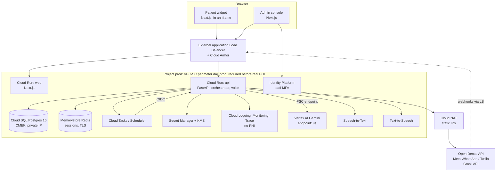
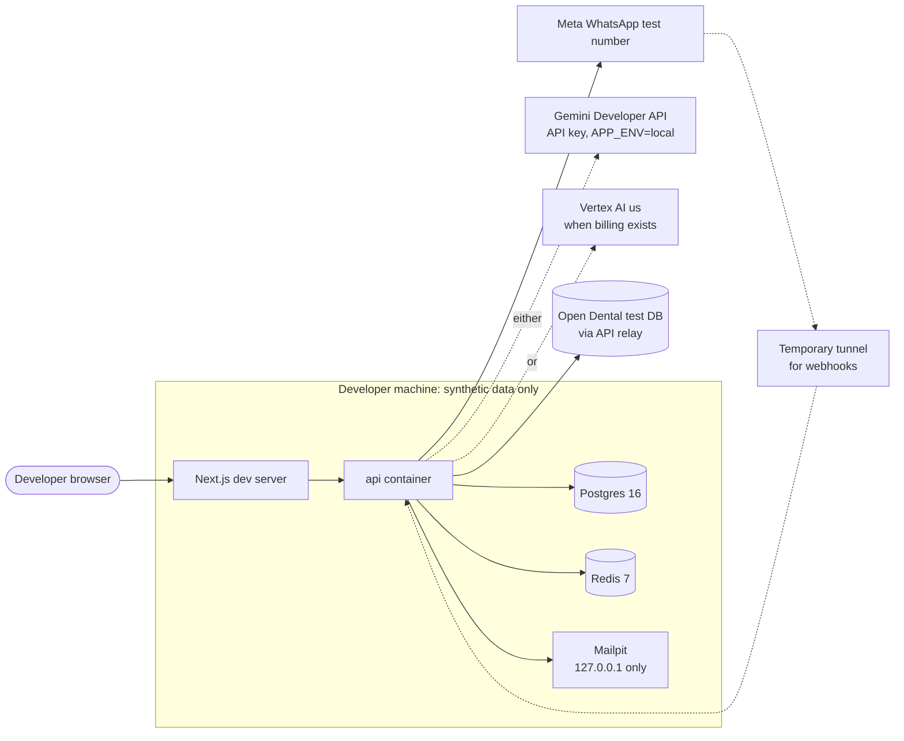

# Level 2: containers

What runs where, for the Google Cloud target. Settings are in [ADR 0002](../adr/0002-runtime-cloud-run.md) and [network.md](network.md).

## 1. Cloud view (dev, staging, prod)

**Two Cloud Run services** (Proposed, ADR 0002):
- `web` serves the widget, `embed.js` and the admin console.
- `api` serves REST, the WebSocket (voice and streaming chat), the webhooks and the Cloud Tasks handlers.
- Cloud Tasks call `api` on internal paths with OIDC tokens (sources A16).
- A separate `worker` or `voice` service is added only if P3-01 or P5-03 (load tests, was P5-06) shows a need.

## 2. Local view (today, DECISIONS #302)

`docker compose` runs `api`, Postgres and Redis (P1-01). Secrets come from the git-ignored `.env`; logs go to the console. **No real patient data on laptops** (risk R38).

## 3. Component responsibilities
Maps to the repo layout in CLAUDE.md. Task IDs are survivors ("was" names the merged ID).

| Module | Owns | Tasks |
|---|---|---|
| `backend/app/api/` | HTTP and WebSocket routes, session handshake, webhooks, internal task routes | P1-01 (was P1-08), P2-25, P3-02, P4-01 |
| `backend/app/orchestrator/` | State machine, slot memory, model router, context builder, tool gateway | P2-01 (incl. P2-02), P2-03 (incl. P2-06), P2-04, P2-08 |
| `backend/app/tools/` | The backend tools (patient, appointment, info) | P1-22 (incl. P1-23, P1-24) |
| `backend/app/domain/` | Patients, scheduling, callbacks, reminders, consent, clinic config, emergency rules | P1-19, P1-20, P2-12, P2-15, P2-16, P2-18, P2-20, P2-22, P4-02, P4-04 |
| `backend/app/integrations/` | `open_dental/`, `vertex_ai/`, `speech/`, `messaging/`, `email/` | P1-15, P1-16, P2-03, P3-03, P4-01, P2-22 (was P2-23) |
| `backend/app/voice/` | Audio frames, server VAD, barge-in, read-back | P3-02, P3-03, P3-06, P3-09 |
| `backend/app/core/` | Config, PHI-redacting logging, audit, field encryption, security | P1-01, P1-05 (was P1-10), P1-07 (was P1-11, P1-12), P1-13 |
| `backend/app/db/` | Models and Alembic migrations | P1-03 (was P1-09) |
| `frontend/` | Widget (`/widget`, `embed.js`), cards, avatar; admin console (`/admin`) | P2-25, P2-27, P3-11, P4-09, P4-11, P4-13, P4-13a |
| `infra/` | Terraform for projects, network, data stores, secrets, CI | P1-02, P1-03, P1-05, P1-06 |

## 4. Google services used
One row per API. `cloud` rows must be in [`infra/org/allowed_services.yaml`](../../infra/org/allowed_services.yaml) (`services` or `always_on`); `workspace` rows are covered by the Workspace BAA instead. `scripts/compliance/check_phi_flows.py` checks this table.

| API | Kind | Used for |
|---|---|---|
| `run.googleapis.com` | cloud | Cloud Run services `web` and `api` |
| `compute.googleapis.com` | cloud | VPC, firewall, load balancer, Cloud Armor, Cloud NAT, Private Service Connect endpoint |
| `dns.googleapis.com` | cloud | Private zones for the restricted VIP and the Vertex AI PSC endpoint |
| `servicenetworking.googleapis.com` | cloud | Private services access, if P1-02 picks it over PSC for Cloud SQL and Memorystore |
| `sqladmin.googleapis.com` | cloud | Cloud SQL Postgres |
| `redis.googleapis.com` | cloud | Memorystore for Redis |
| `cloudtasks.googleapis.com` | cloud | Reminder and email jobs |
| `cloudscheduler.googleapis.com` | cloud | Periodic jobs (retention, unsent-email alerts) |
| `secretmanager.googleapis.com` | cloud | Open Dental keys, messaging tokens |
| `cloudkms.googleapis.com` | cloud | CMEK and field encryption keys |
| `aiplatform.googleapis.com` | cloud | Gemini on Vertex AI, `us` multi-region |
| `speech.googleapis.com` | cloud | Streaming Speech-to-Text |
| `texttospeech.googleapis.com` | cloud | Text-to-Speech |
| `identitytoolkit.googleapis.com` | cloud | Identity Platform, staff MFA |
| `artifactregistry.googleapis.com` | cloud | Container images |
| `logging.googleapis.com` | cloud | Logs (no PHI) |
| `monitoring.googleapis.com` | cloud | Metrics and alerts |
| `cloudtrace.googleapis.com` | cloud | Traces (no PHI in span names or attributes) |
| `gmail.googleapis.com` | workspace | Callback emails (`gmail.send`, keyless delegation, P0-08) |
