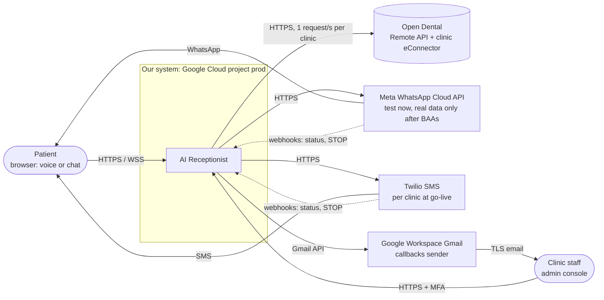

# Level 1: system context

Who uses the AI receptionist and which outside systems it talks to. Hosting is shown as Google Cloud, the plan's target. Hosting is still open (DECISIONS #302); see [README §4](README.md#4-if-hosting-is-not-google-cloud).

| Actor or system | What it does with us | Vendor id ([vendors.yaml](../compliance/vendors.yaml)) |
|---|---|---|
| Patient | Talks or types in the widget on the clinic website; receives confirmations and reminders | - |
| Clinic staff | Uses the admin console (MFA) for callback cases, settings and the AI activity log; receives callback emails | - (the clinic is the covered entity) |
| Open Dental | Source of truth for patients and appointments; reached through Open Dental's API relay and the clinic's eConnector (P0-12) | `open-dental` |
| Meta WhatsApp Cloud API | WhatsApp messages; synthetic data only until the Meta and provider BAAs are signed (DECISIONS #299, #300) | `meta-whatsapp` |
| Twilio | SMS messages for clinics that choose SMS at go-live | `twilio` |
| Google Workspace (Gmail) | Sends callback emails, `link_only` by default (DECISIONS #303); not bought until production (DECISIONS #304) | `google-workspace` |
| Google Cloud | Hosts everything in "Our system", including Gemini, Speech-to-Text and Text-to-Speech | `google-cloud` |

**Not in the picture on purpose:**
- **No live call transfer.** Unresolved requests become callback cases (plan §4.9).
- **No analytics or tracking scripts** in the widget (CLAUDE.md rule 5).
- **No Gemini Developer API in any cloud environment.** It exists only on developer machines with synthetic data ([phi-flows.md](phi-flows.md), flow F17).
