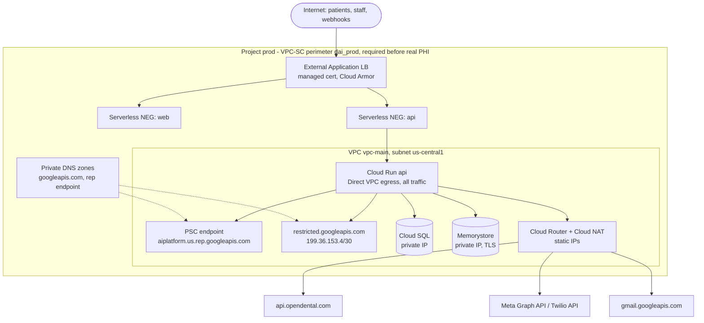

# Network map

**Proposed; P1-02 builds it.** Nothing here exists yet: no Google Cloud resources are created until the client chooses hosting (DECISIONS #302). Facts are from Google's pages read on 2026-11-26, cited as sources A1–A22 in [sources/README.md](../compliance/sources/README.md#p0-14-architecture-checked-2026-11-26).

## 1. Picture (one environment; dev, staging and prod are the same shape)

## 2. Settings
| Element | Setting | Source or status |
|---|---|---|
| Projects | `dai-rcpt-dev`, `-staging`, `-prod` (app); `-ops` (state, CI, never PHI) | P0-05 |
| VPC | `vpc-main` per app project, one subnet in `us-central1`, Private Google Access on | Proposed |
| Ingress | External Application Load Balancer with serverless NEGs for `web` and `api`; Google-managed certificate; Cloud Armor (rate limits, bot rules, P2-25 was P2-29). Cloud Run ingress **Internal and Cloud Load Balancing**, so the `run.app` URL can't bypass the load balancer | A7, A8 |
| WebSocket | Through the same load balancer to `api`; request timeout 3600 s; session affinity on (best effort); clients reconnect | A1–A3; ADR 0002, 0004 |
| Egress from Cloud Run | **Direct VPC egress**, all traffic routed to the VPC. Google recommends a Serverless VPC Access connector with Cloud NAT for faster cold starts (A5), but the connector isn't on the HIPAA covered list (A21) and is dropped from `allowed_services.yaml`. So: Direct VPC egress plus min instances ≥ 1 and an HTTP startup probe with retries to absorb the 30 s+ first-connection delay | A5, A21; P0-06 |
| Google APIs | Private DNS zone sends `*.googleapis.com` to the **restricted VIP** (VPC-SC-supported APIs only) | A10 |
| Vertex AI (`us`) | `aiplatform.us.rep.googleapis.com` is **not** served by the private VIP domains (A10 excludes `*.rep.googleapis.com`); it's reached through a **Private Service Connect regional endpoint** in `us-central1` plus a private DNS record | A10, A11 |
| Gmail API | **Not** served by the restricted VIP (Workspace API, A10) and not a VPC-SC service (A9); reached over the internet through Cloud NAT, TLS, keyless delegation. It's the one planned egress to a Google API outside the perimeter | A9, A10 |
| Cloud SQL | Private IP only, **Private Service Connect** (Google's default and recommended option; private services access only if P1-02 needs it); no public IP (org policy, P0-06); IAM database authentication | A12, A13 |
| Memorystore for Redis | Private IP; in-transit encryption (TLS 1.2+); AUTH; CMEK only if persistence is on, and only at creation | A14, A15 |
| Cloud Tasks | HTTP target `api` internal routes with an OIDC token from a queue service account in the same project | A16 |
| Internet egress | Cloud NAT with static IPs (for allow-lists at vendors). Allowed destinations: `api.opendental.com`, the Meta Graph API host, the Twilio API host, `gmail.googleapis.com`. FQDN egress firewall rules: open question Q3 | A6 |
| Perimeters | `dai_prod`, `dai_staging`, `dai_dev` written in `infra/org/`, **not applied** (needs an organization, DECISIONS #296). Cloud Run needs extra VPC-SC setup; Cloud SQL and Memorystore perimeters protect only their admin APIs, not network data access (so private IP and IAM matter) | A9; risk R34 |
| Public DNS | The clinic-facing domain's public zone lives **outside** the prod perimeter (Cloud DNS can't create public zones inside one) | A9 |
| Admin access | No SSH or RDP into prod; the Open Dental test DB VM in dev only through IAP (P0-12) | P0-12 |

## 3. Resource list (per app project)
| Resource | Name (Proposed) | Task |
|---|---|---|
| VPC and subnet | `vpc-main`, `snet-us-central1` | P1-02 |
| Cloud Router and NAT, 2 static IPs | `cr-main`, `nat-main` | P1-02 |
| Private DNS zones | `googleapis` (restricted VIP), `aiplatform-us-rep` (PSC endpoint) | P1-02 |
| PSC endpoint for Vertex AI `us` | `psc-aiplatform-us` | P1-02 |
| Load balancer, NEGs, certificate, Cloud Armor policy | `lb-public`, `neg-web`, `neg-api`, `armor-public` | P1-02 |
| Cloud Run services | `web`, `api` | P1-02, P1-06 |
| Cloud SQL instance (HA in prod) | `sql-main` | P1-03 |
| Memorystore instance | `redis-main` | P1-02 (was P1-04) |
| Cloud Tasks queues, Scheduler jobs | `q-reminders`, `q-emails` | P1-02 (was P1-04) |
| KMS key ring, keys; Secret Manager secrets | `kr-main` | P1-05 |

## 4. Open questions for P1-02
| # | Question | Why it's open |
|---|---|---|
| Q1 | Can VPC-SC policy reach the PSC endpoint for `aiplatform.us.rep.googleapis.com` the same way as the restricted VIP (perimeter enforcement for requests through PSC)? | A9 lists regional endpoints as supported destinations for Cloud Run, but no page read today states it for PSC endpoints in a perimeter |
| Q2 | Can Cloud Tasks reach `api` while `api`'s ingress is "Internal and Cloud Load Balancing" inside a perimeter? | A9 says Cloud Tasks may call VPC-SC-compliant `run.app` endpoints; P1-02 tests it |
| Q3 | Egress firewall allow-list by FQDN for the four internet destinations | Not checked today; fallback is Cloud NAT with no FQDN filtering plus app-level host allow-list |
| Q4 | Gmail egress outside the perimeter: does a VPC-SC egress rule or the absence of one block calls from `api` to `gmail.googleapis.com` through NAT? | Gmail isn't a VPC-SC service (A9); P1-02 tests it |
| Q5 | Cold start with Direct VPC egress and NAT: is min instances ≥ 1 plus a startup probe enough for voice? | A5; P3-14 measures |
