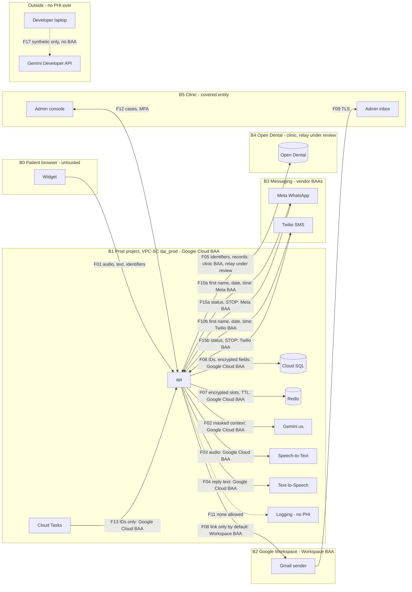

# PHI data flows and trust boundaries

**This file is the single source of truth for where PHI may go.**
- The risk assessment (P0-11) and the clinic BAA [Annex A](../compliance/baa/annex-a-data-and-purposes.md) (P0-09) must match it.
- If the diagram and the table disagree, **the table wins**; fix the diagram in the same change.
- `scripts/compliance/check_phi_flows.py` checks the table against the P0-04 slot list, [`vendors.yaml`](../compliance/vendors.yaml) and the allowed Google services.

Status on 2026-11-26: **no BAA is signed** (all paper records, DECISIONS #301, #304, #306), so the PHI gate is CLOSED (P0-10) and every flow carries **synthetic data only**. The BAA column names the agreement that must be signed before real PHI uses the hop.

## 1. Trust boundaries

| Boundary | What is inside | Covered by |
|---|---|---|
| B0 Patient browser | Widget, microphone | Untrusted |
| B1 Our prod project | `api`, `web`, Cloud SQL, Redis, Cloud Tasks, Gemini (`us`), Speech-to-Text, Text-to-Speech, Logging; VPC-SC perimeter `dai_prod` (written, **not applied** until an organization exists, DECISIONS #296) | Google Cloud BAA |
| B2 Google Workspace | Gmail sender for callback emails | Workspace BAA |
| B3 Messaging vendors | Meta WhatsApp Cloud API; Twilio SMS | Each vendor's BAA |
| B4 Open Dental | API relay (Open Dental's servers) and the clinic's eConnector and database | Clinic is the covered entity; relay coverage under review (R36) |
| B5 Clinic | Staff browsers, admin inbox | Covered entity |
| Outside | Developer laptops, Gemini Developer API, GitHub | **No PHI ever** |

F14 (backups) stays inside B1 and F16 (Open Dental test DB) carries synthetic data only; both are in the table, not the diagram.

## 2. PHI flow table

**Field names.** P0-04 slot names in backticks (`first_name`, `last_name`, `dob`, `phone`, `zip`, `email`, `address`, `mobile_phone`, `reason_text`, `whatsapp_number`, `situation`). Other data uses these fixed names:
- `audio`: the patient's voice;
- `chat_text`: typed or transcribed patient turns;
- `reply_text`: the assistant's reply;
- `pat_num`, `apt_num`: Open Dental IDs (linkable to a patient, Annex A A2);
- `appointment_time`: date and time of an appointment;
- `od_records`: patient and appointment records returned by Open Dental;
- `case_summary`: the encrypted callback summary;
- `consent_record`: consent and opt-out rows;
- `message_status`: delivery status and inbound reply text (such as STOP).

| ID | From → To | Fields | PHI | Purpose | Vendor id | BAA (status) | Annex A | Protection | Environments | Owner tasks |
|---|---|---|---|---|---|---|---|---|---|---|
| F01 | Widget → `api` | `audio`, `chat_text`, `first_name`, `last_name`, `dob`, `phone`, `zip`, `email`, `address`, `mobile_phone`, `reason_text`, `whatsapp_number`, `situation` | yes | Conversation | - | - (our system) | A1, A3, A4, A6 | TLS 1.2+ through the load balancer; session token; no PHI in URLs or query strings | all | P2-25, P3-02, P1-13 (was P1-14) |
| F02 | `api` → Gemini on Vertex AI (`us`) | `chat_text` (last turns), `reason_text`, `situation`; identifiers `first_name`, `last_name`, `dob`, `phone`, `zip`, `email`, `address`, `mobile_phone` **masked where P2-04 allows** | yes | Extraction, replies | `google-cloud` | Google Cloud BAA (pending) | A1, A3, A7 | Private Service Connect endpoint for `aiplatform.us.rep.googleapis.com` (sources A11); GA models; GenerateContent; no grounding; `cacheConfig` EPHEMERAL; no request-response logging (ADR 0001) | all | P2-03, P2-04, P0-13 |
| F03 | `api` → Speech-to-Text | `audio` | yes | Transcription | `google-cloud` | Google Cloud BAA (pending) | A6 | US location; data logging off (P0-06); restricted VIP | all | P3-03 |
| F04 | `api` → Text-to-Speech | `reply_text` (may contain `first_name`, `appointment_time`) | yes | Speech | `google-cloud` | Google Cloud BAA (pending) | A1, A3 | US location; restricted VIP | all | P3-03 (was P3-05) |
| F05 | `api` ↔ Open Dental | Sent: `first_name`, `last_name`, `dob`, `phone`, `zip`, `email`, `address`, `mobile_phone`, `pat_num`, `apt_num`. Returned: `od_records` | yes | Identify, register, book | `open-dental` | Clinic BAA (not signed); relay coverage under review | A1, A2 | TLS; Cloud NAT static IPs; keys in Secret Manager; 1 request/s per clinic; minimum fields returned to the conversation | prod | P1-15, P1-16, P0-12 |
| F06 | `api` → Cloud SQL | `pat_num`, `apt_num`; encrypted `phone`, `whatsapp_number`, `mobile_phone`, `first_name`, `last_name`, `situation`, `case_summary`; `consent_record`; audit log (IDs only) | yes | References, callback cases, consent | `google-cloud` | Google Cloud BAA (pending) | A1–A4, A8 | Private IP (PSC), CMEK, field encryption (KMS envelope), IAM DB auth | all | P1-03, P1-05, P2-22, P4-02 |
| F07 | `api` → Memorystore Redis | Session slots (all P0-04 slots, encrypted), last N `chat_text` turns | yes | Session state | `google-cloud` | Google Cloud BAA (pending) | A1, A3, A7 | Private IP, TLS (sources A14), AUTH, field encryption, TTL; CMEK only for persistence, set at creation (A15) | all | P1-02 (was P1-04), P2-01 (was P2-02) |
| F08 | `api` → Gmail API | `link_only` (default): urgency, time, case ID, **no PHI**. `full_details` (approved clinics only): `first_name`, `last_name`, `phone`, `situation` | yes (full_details only) | Callback notice | `google-workspace` | Workspace BAA (pending) | A5 | Keyless delegation, `gmail.send` only; subject never contains PHI; via Cloud NAT (the restricted VIP doesn't serve Gmail, sources A10) | prod | P2-22 (was P2-23), P0-08 |
| F09 | Gmail → clinic admin inbox | As F08 | yes (full_details only) | Callback notice | `google-workspace` | Workspace BAA (pending) | A5 | TLS compliance rule (non-TLS bounces) | prod | P0-08 |
| F10a | `api` → Meta WhatsApp Cloud API → patient | `first_name`, `appointment_time`, `whatsapp_number` (clinic name and phone are not PHI) | yes | Confirmation, reminder | `meta-whatsapp` | Meta BAA (pending); **synthetic only** until it and the gate allow (`messaging_policy.yaml`) | A4 | Consent required; opt-out; template content only | dev, staging, prod | P4-01, P4-03, P4-04, P0-07 |
| F10b | `api` → Twilio → patient | `first_name`, `appointment_time`, `mobile_phone` | yes | Confirmation, reminder | `twilio` | Twilio BAA (pending; Security or Enterprise Edition) | A4 | Consent required; opt-out; template content only | staging, prod | P4-01, P4-03, P4-04, P0-07 |
| F11 | `api` → Cloud Logging, Monitoring, Trace | **None allowed**: IDs, state names, timings, codes only | no | Operations | `google-cloud` | Google Cloud BAA (pending) | A8 (PHI-free copy) | PHI-redacting logger; no PHI in span names; scans | all | P1-07 (was P1-11), P5-08 |
| F12 | Admin console ↔ `api` | Callback cases (`first_name`, `last_name`, `phone`, `situation`), activity log (role-filtered) | yes | Staff work | - | - (our system; clinic staff) | A1, A3, A8 | MFA (Identity Platform), RBAC, audit log | all | P1-13, P4-09, P4-13a |
| F13 | Cloud Tasks → `api` | `apt_num`, reminder or case ID only; **never names or contact details** | yes (IDs only) | Reminder and email jobs | `google-cloud` | Google Cloud BAA (pending) | A2 | OIDC token from a queue service account (sources A16); internal route; handler re-fetches | all | P4-04, P2-22 |
| F14 | Cloud SQL → backups and point-in-time recovery | As F06 | yes | Recovery | `google-cloud` | Google Cloud BAA (pending) | A1–A4, A8 | CMEK, US location, 30 daily backups | prod | P1-03, P5-12 (was P5-13) |
| F15a | Meta webhooks → `api` | `whatsapp_number`, `message_status` | yes | Delivery status, opt-out | `meta-whatsapp` | Meta BAA (pending) | A4 | HTTPS through the load balancer; signature check; no payload in logs | dev, staging, prod | P4-01 |
| F15b | Twilio webhooks → `api` | `mobile_phone`, `message_status` | yes | Delivery status, opt-out | `twilio` | Twilio BAA (pending) | A4 | HTTPS through the load balancer; signature check; no payload in logs | staging, prod | P4-01 |
| F16 | `api` (dev, staging, local) ↔ Open Dental test DB | Synthetic patients and appointments only | no | Development and tests | `open-dental` | - (synthetic only, P0-12) | - | Test keys only; guard on target (`OD_TARGET=testdb`) | local, dev, staging | P0-12, P1-15 |
| F17 | Developer laptop → Gemini Developer API | Synthetic eval and dev prompts only | no | Local development, spike | `google-ai-studio` | None, and none possible: **never PHI** (DECISIONS #316) | - | Startup check `APP_ENV=local`; key in git-ignored `.env` | local | P0-13, P2-03 |

## 3. Rules
- **R-A:** every PHI row (`PHI` not `no`) names a vendor id whose `vendors.yaml` row has `phi: yes` or `conditional`, and a BAA. Rows inside our system use `-`.
- **R-B:** a new PHI hop, or a new field on a hop, needs one change that updates this table, `vendors.yaml` (if a vendor is added) and Annex A, reviewed by the compliance owner (proposed CODEOWNERS entry in [pr-vendor-check.md](../compliance/pr-vendor-check.md)).
- **R-C:** dev and staging run the same flows with **synthetic data only**; the Open Dental edge there is F16.
- **R-D:** no PHI in URLs, query strings, logs, metrics, traces, error responses, analytics or task payloads (F11, F13).
- **R-E:** Gemini is reached only through our P2-03 provider on Vertex AI. No library's API-key path (Pipecat `GoogleLLMService`, `GeminiSTTService`, the GenAI backend of `GeminiTTSService`) in any cloud environment; Pipecat's `GoogleVertexLLMService` defaults to `global` (sources A17) and is not used (ADR 0003).
- **R-F:** a flow whose vendor isn't in `vendors.yaml` is **blocked** until P0-10 adds it with its BAA status.

## 4. Mapping from the P0-11 interim flows
| P0-11 flow | Now |
|---|---|
| F1 | F01 |
| F2 | F02 |
| F3 | F03, F04 |
| F4 | F05 (and F16 for test data) |
| F5 | F06, F07, F13, F14 |
| F6 | F08, F09 |
| F7 | F10a, F10b, F15a, F15b |
| F8 | F11 |
| F9 | F12 |

The P0-11 asset IDs A01–A18 stay valid; [containers.md](containers.md) shows where each asset runs.

## 5. Annex A check (2026-11-26)
Every Annex A row (A1–A8) appears in the table, and every PHI row names an Annex A row. Differences found:
- Inbound webhooks (F15a, F15b) carry the messaging number back to us; Annex A A4 covers the number but names only sending. P0-09 adds "and receives delivery status and replies" to A4 at the next revision.
- Annex B B1 lists "logging" as receiving PHI rows; F11 allows none. P0-09 clarifies at the next revision.
