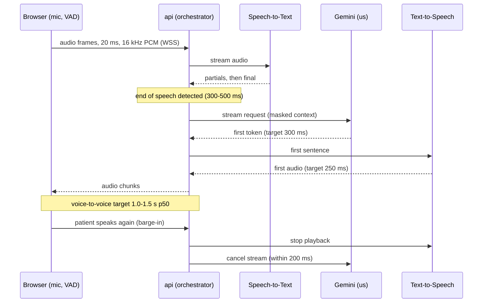
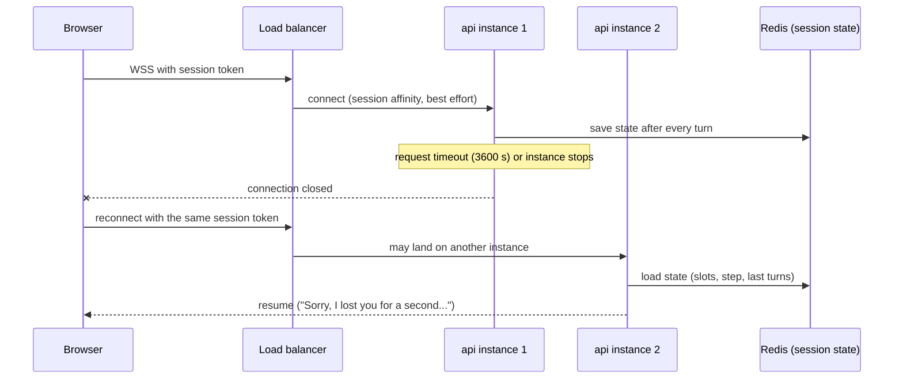
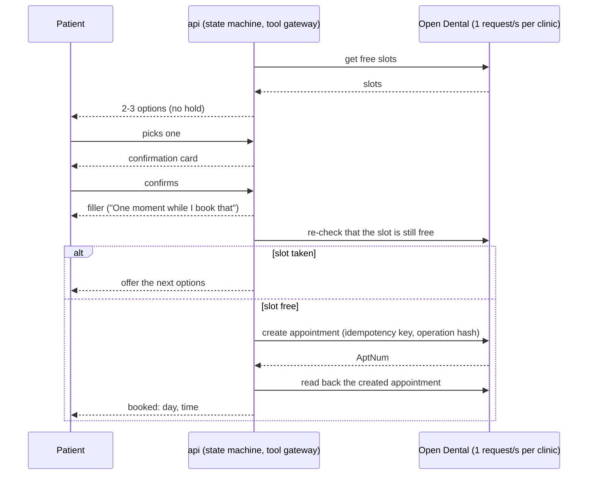
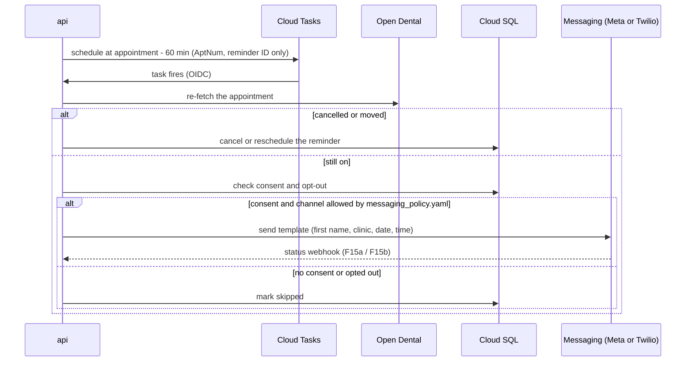

# Sequences

Four main paths plus the reconnect. Plain-language notes follow each diagram.

## S1: Voice turn and latency budget (plan §4.4)



| Stage | Target | Measured |
|---|---|---|
| End of speech detection | 300–500 ms | P3-03, P3-14 |
| Gemini first token | ≤ 300 ms (flash tier) | Pending: P0-13 live run deferred; Vertex `us` not measured (ADR 0001 §4) |
| TTS first audio | ≤ 250 ms | P3-03 |
| Voice to voice | 1.0–1.5 s p50 | P3-14 |

### S1b: Reconnect (WebSocket cut at 60 minutes or instance loss)



Every confirmed step is in Redis before the reply is sent, so a reconnect never loses it (P2-01, P3-02). A write that was in flight when the connection broke is resolved by its idempotency key (S2).

## S2: Booking (plan §4.6; no slot hold, DECISIONS #146, #290)



- Nothing is held at offer or selection. A collision shows up at the re-check, or as a conflict on create, and the patient gets new options.
- The create uses exactly what the patient confirmed (operation hash) and an idempotency key, so a retry after a timeout can't double-book (P2-08).
- Calls to Open Dental queue behind the 1 request/second limit (P1-15); the filler phrase covers the wait.

## S3: Callback (P2-22, `link_only` email, DECISIONS #303)

```mermaid
sequenceDiagram
  participant P as Patient
  participant A as api
  participant D as Cloud SQL
  participant Q as Cloud Tasks
  participant M as Gmail API
  P->>A: wants a person / can't be resolved
  A-->>P: collect name, phone, situation; read back
  P->>A: confirms
  A->>D: insert callback case (encrypted fields)
  A->>Q: enqueue email task (case ID only)
  A-->>P: "The clinic will call you back"
  Q->>A: run task (OIDC)
  A->>D: load case
  A->>M: send link_only email (urgency, time, case ID, link)
  alt sent
    A->>D: email_status = sent
  else retries exhausted
    A->>D: email_status = failed
    A->>A: unsent alert to staff (console + monitoring)
  end
```

## S4: Reminder (P4-04, appointment − 60 minutes, DST-aware)



The task payload carries IDs only; the handler re-fetches everything (F13).
