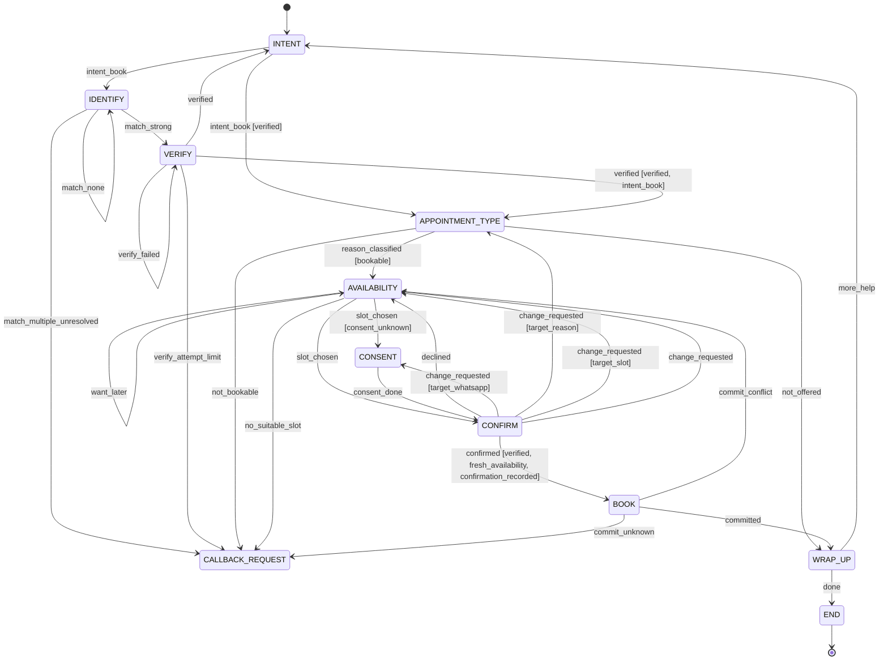

# Flow 1: Book an appointment (existing patient)

- **State machine:** [state_machine.yaml](state_machine.yaml) version 0.2 (the YAML wins if this page disagrees) · **Overview:** [overview.md](overview.md)
- **Golden conversation:** `evals/golden/book-existing-patient.yaml`

## 1. Purpose and entry
A returning patient books a visit. Entry: intent `book` from `INTENT` (or `intent_changed` / `switch_patient` back to `INTENT`).

## 2. Diagram
Generated from the YAML (edge label = event, guards in brackets). Global interrupts (emergency, ask for a person, Open Dental down, FAQ, idle timeout) apply in every state and are listed in [overview.md](overview.md#global-interrupts).

## 3. Steps
What the AI says is the *intent* of the reply, not final wording (P2-04 / P2-07 own the text).

| State | What the AI asks or says | Tools | Slots collected | Exits |
|---|---|---|---|---|
| INTENT | Asks how it can help; recognises *book*. Already verified in this session → skips to `APPOINTMENT_TYPE`. | - | `intent` | `intent_book` |
| IDENTIFY | Asks for full name and date of birth (and phone if needed). Replies stay neutral: "Thanks, let me check". Never says whether a record exists. | `search_patient` | `first_name`, `last_name`, `dob`, `phone` (PHI) | `match_strong` → VERIFY; `match_partial` → ask another identifier; `match_none` → confirm spelling and DOB once; `match_multiple_unresolved` → callback |
| VERIFY | Asks for the second identifier: mobile phone or home ZIP (P0-01 Q1). Never phone alone. | `verify_patient` | `zip` (PHI) | `verified` → continue the intent; `verify_failed` → ask again; `verify_attempt_limit` → callback |
| APPOINTMENT_TYPE | Asks the reason for the visit; code maps it to a type from the clinic config (P0-02), the LLM never decides. | - | `reason_code`, `reason_text` (PHI) | `reason_classified [bookable]` → AVAILABILITY; `not_bookable` → callback; `not_offered` → explain, WRAP_UP |
| AVAILABILITY | Offers 2–3 real times from Open Dental in the clinic time zone; "Later times" asks again. | `get_appointment_availability` | `preferred_time`, `chosen_slot` | `slot_chosen` → CONSENT (no consent on record) or CONFIRM; `no_suitable_slot` → callback |
| CONSENT | If no WhatsApp consent is on record: asks once whether to send confirmations and reminders on WhatsApp, and checks the number (DECISIONS #256). | `record_consent` | `consent_whatsapp`, `whatsapp_number` (PHI) | `consent_done` → CONFIRM (yes or no) |
| CONFIRM | Shows the confirmation card (patient, type, date, time, dentist, WhatsApp number) and asks for an explicit yes (DECISIONS #174). | - | `confirmation` | `confirmed` → BOOK; `change_requested` → the state that collects the field; `declined` → AVAILABILITY |
| BOOK | Books in Open Dental with the confirmed values only; done only when Open Dental confirms. | `book_appointment` | `apt_num` | `committed` → WRAP_UP; `commit_conflict` → AVAILABILITY with fresh times; `commit_unknown` → callback |
| WRAP_UP | Summarises and asks "Is there anything else?" | - | - | `more_help` → INTENT; `done` → END |

## 4. Failure branches
- Several records match and name + DOB don't resolve it → `CALLBACK_REQUEST` (`match_multiple_unresolved`).
- Verification fails 3 times in the session → `CALLBACK_REQUEST` (`verify_attempt_limit`); no record details are revealed.
- Reason maps to `callback` in the clinic config → `CALLBACK_REQUEST` (`not_bookable`).
- No suitable time after 3 offer rounds → `CALLBACK_REQUEST` (`no_suitable_slot`).
- The slot is taken between offer and commit → `AVAILABILITY` with fresh options (`commit_conflict`); no slot hold (DECISIONS #146).
- The write's outcome is unknown (timeout, `in_progress`) → `CALLBACK_REQUEST` (`commit_unknown`, reason `booking_needs_confirmation`); staff check Open Dental.
- Global: emergency phrase → `EMERGENCY`; "talk to a person", 2 misunderstandings, Open Dental down → `CALLBACK_REQUEST`; silence → `END` with nothing booked.

## 5. Clinic-dependent points
- Verification identifiers: name + DOB + mobile phone or ZIP (P0-01 Q1).
- Which reasons the AI may book: new-patient exam, recall/cleaning, emergency exam (P0-01 Q3, P0-02).
