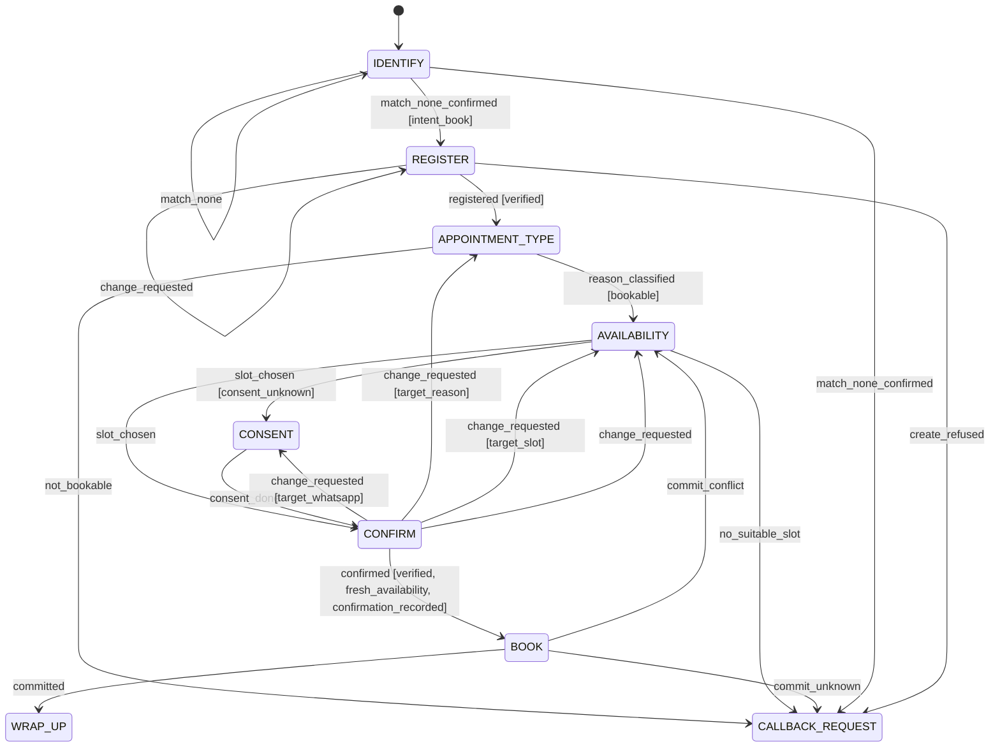

# Flow 2: Book an appointment (new patient)

- **State machine:** [state_machine.yaml](state_machine.yaml) version 0.2 (the YAML wins if this page disagrees) · **Overview:** [overview.md](overview.md)
- **Golden conversation:** `evals/golden/book-new-patient.yaml`

## 1. Purpose and entry
Someone with no record books a first visit. Entry: intent `book` (or the Tier 2 urgent path), and `IDENTIFY` finds no match after one more spelling and DOB check.

## 2. Diagram
Generated from the YAML (edge label = event, guards in brackets). Global interrupts (emergency, ask for a person, Open Dental down, FAQ, idle timeout) apply in every state and are listed in [overview.md](overview.md#global-interrupts).

## 3. Steps
What the AI says is the *intent* of the reply, not final wording (P2-04 / P2-07 own the text).

| State | What the AI asks or says | Tools | Slots collected | Exits |
|---|---|---|---|---|
| IDENTIFY | Searches anyway (duplicate prevention). No match → confirms spelling and DOB once more, neutrally. | `search_patient` | `first_name`, `last_name`, `dob`, `phone` (PHI) | `match_none_confirmed [intent_book]` or `[urgent]` → REGISTER; otherwise → callback |
| REGISTER | Collects the new-patient details, shows a registration card (DOB shown, not spoken), creates the record immediately when there's no duplicate risk (P0-01 B4). | `search_patient`, `create_patient` | `email`, `address`, `mobile_phone` (PHI) | `registered` → APPOINTMENT_TYPE (or CONSENT / CONFIRM on the urgent path); `create_refused` → callback; `change_requested` → re-ask that field |
| APPOINTMENT_TYPE … BOOK | As in flow 1. A new patient books the new-patient exam; the booking is marked "AI-booked" for staff review (P0-01 Q2). | as flow 1 | as flow 1 | as flow 1 |

## 4. Failure branches
- Create refused (duplicate risk, missing required field, any doubt) → `CALLBACK_REQUEST` (`create_refused`); staff create the record.
- No match while the intent is reschedule, cancel or check → `CALLBACK_REQUEST`: there is nothing to change without a record.
- Plus every failure branch of flow 1 after `REGISTER`.

## 5. Clinic-dependent points
- Create new patients immediately when there's no duplicate risk (P0-01 B4).
- New-patient bookings are flagged for staff review with an "AI-booked" note (P0-01 Q2).
