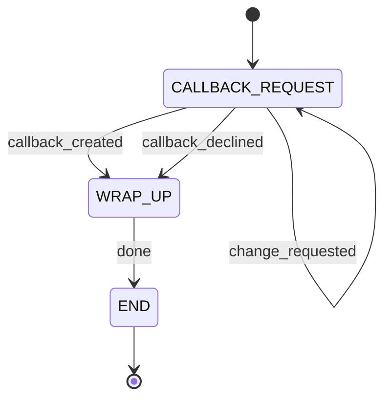

# Flow 8: Callback request

- **State machine:** [state_machine.yaml](state_machine.yaml) version 0.2 (the YAML wins if this page disagrees) · **Overview:** [overview.md](overview.md)
- **Golden conversation:** `evals/golden/callback.yaml`

## 1. Purpose and entry
The AI can't finish the request, or the patient asks for a person or has a complaint (DECISIONS #170). Entry: global `human_requested`, `not_understood_limit`, `od_unavailable`, or a flow's failure branch. There is no live transfer.

## 2. Diagram
Generated from the YAML (edge label = event, guards in brackets). Global interrupts (emergency, ask for a person, Open Dental down, FAQ, idle timeout) apply in every state and are listed in [overview.md](overview.md#global-interrupts).

## 3. Steps
What the AI says is the *intent* of the reply, not final wording (P2-04 / P2-07 own the text).

| State | What the AI asks or says | Tools | Slots collected | Exits |
|---|---|---|---|---|
| CALLBACK_REQUEST | Collects name, phone, the situation and the best time (new or existing patient), shows a card with name and phone, then creates one case per session and reason. | `create_callback_request` | `first_name`, `last_name`, `phone`, `situation` (PHI), `callback_time` | `callback_created` → WRAP_UP with the promise; `change_requested` → re-ask that field; `callback_declined` ("never mind") → WRAP_UP |

## 4. Failure branches
- Case creation fails → the AI apologises and gives the clinic's opening hours; the error is logged without PHI (P2-22).

## 5. Clinic-dependent points
- Promise: "The team will call you back within one business day"; URGENT the same business day (P0-01 B6).
- All callbacks go to one shared mailbox, frontdesk@example.com, for all hours (P0-01 Q4b).
