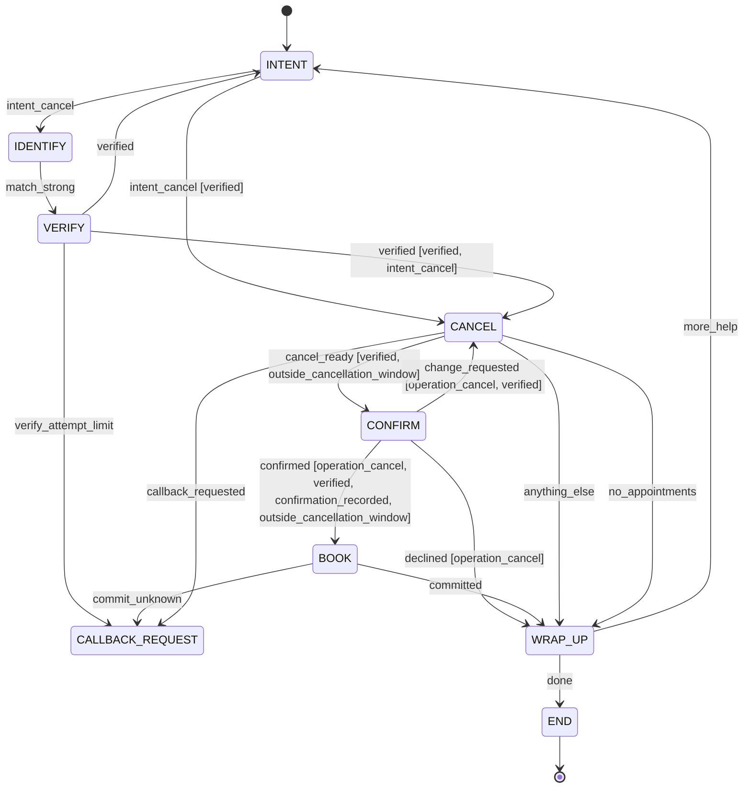

# Flow 4: Cancel an appointment

- **State machine:** [state_machine.yaml](state_machine.yaml) version 0.2 (the YAML wins if this page disagrees) · **Overview:** [overview.md](overview.md)
- **Golden conversation:** `evals/golden/cancel.yaml`

## 1. Purpose and entry
A verified patient cancels an appointment. Entry: intent `cancel`. Unverified → `IDENTIFY` and `VERIFY` first, intent kept. No consent step.

## 2. Diagram
Generated from the YAML (edge label = event, guards in brackets). Global interrupts (emergency, ask for a person, Open Dental down, FAQ, idle timeout) apply in every state and are listed in [overview.md](overview.md#global-interrupts).

## 3. Steps
What the AI says is the *intent* of the reply, not final wording (P2-04 / P2-07 own the text).

| State | What the AI asks or says | Tools | Slots collected | Exits |
|---|---|---|---|---|
| CANCEL | Lists upcoming appointments, asks which one, checks the notice window, asks one optional reason question. | `get_patient_appointments` | `apt_num` | `cancel_ready [verified, outside_cancellation_window]` → CONFIRM; inside the window → callback offer; `no_appointments` → WRAP_UP |
| CONFIRM | Shows the cancel card (patient, date, time, dentist) and asks for an explicit yes. | - | `confirmation` | `confirmed [operation_cancel, verified, confirmation_recorded, outside_cancellation_window]` → BOOK; `declined` → WRAP_UP; `change_requested` → CANCEL |
| BOOK | Cancels in Open Dental. | `cancel_appointment` | - | `committed` → WRAP_UP (soft offer to book a new time) |

## 4. Failure branches
- Inside the 24-hour notice window → no cancel; offer a callback (P0-01 Q5).
- Outcome unknown → `CALLBACK_REQUEST` (`commit_unknown`).

## 5. Clinic-dependent points
- Notice window: 24 hours (P0-01 Q5).
