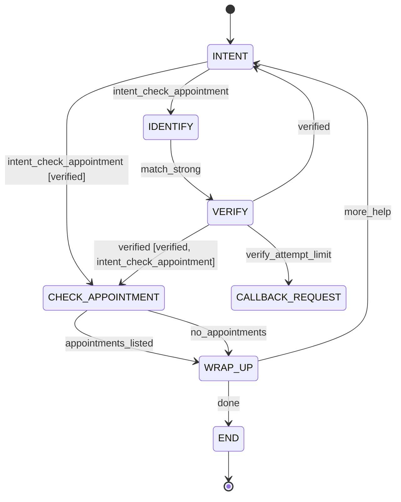

# Flow 5: Check an appointment

- **State machine:** [state_machine.yaml](state_machine.yaml) version 0.2 (the YAML wins if this page disagrees) · **Overview:** [overview.md](overview.md)
- **Golden conversation:** `evals/golden/check-appointment.yaml`

## 1. Purpose and entry
A verified patient asks when their next appointment is. Entry: intent `check_appointment`. Unverified → `IDENTIFY` and `VERIFY` first; nothing is revealed before `VERIFY` succeeds.

## 2. Diagram
Generated from the YAML (edge label = event, guards in brackets). Global interrupts (emergency, ask for a person, Open Dental down, FAQ, idle timeout) apply in every state and are listed in [overview.md](overview.md#global-interrupts).

## 3. Steps
What the AI says is the *intent* of the reply, not final wording (P2-04 / P2-07 own the text).

| State | What the AI asks or says | Tools | Slots collected | Exits |
|---|---|---|---|---|
| CHECK_APPOINTMENT | Lists this verified patient's upcoming appointments (date, time, dentist). | `get_patient_appointments` | - | `appointments_listed` or `no_appointments` → WRAP_UP |

## 4. Failure branches
- Verification fails 3 times → `CALLBACK_REQUEST`; no appointment details are given.

## 5. Clinic-dependent points
- A family member's appointments: only after `add_patient` and that person's own verification (DECISIONS #185; review answer Q5).
