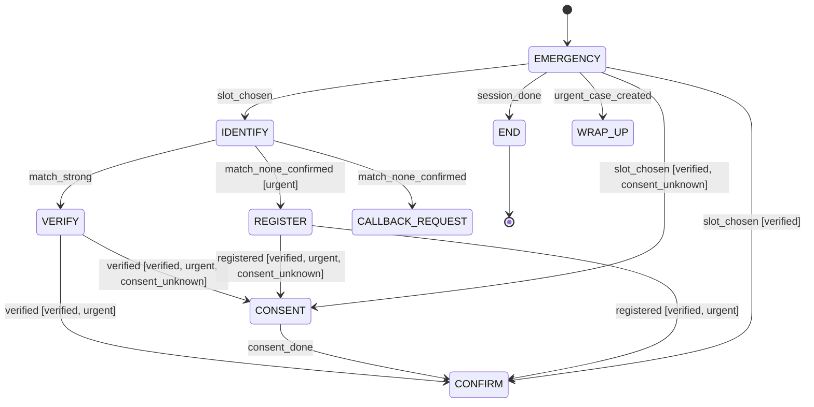

# Flow 7: Emergency

- **State machine:** [state_machine.yaml](state_machine.yaml) version 0.2 (the YAML wins if this page disagrees) · **Overview:** [overview.md](overview.md)
- **Golden conversation:** `evals/golden/emergency.yaml`

## 1. Purpose and entry
The P0-03 rules flag an emergency on any patient turn. Entry: global `emergency_tier1` / `emergency_crisis` (from every state) or `emergency_uncertain` / `emergency_tier2` (from every state except `EMERGENCY`).

## 2. Diagram
Generated from the YAML (edge label = event, guards in brackets). Global interrupts (emergency, ask for a person, Open Dental down, FAQ, idle timeout) apply in every state and are listed in [overview.md](overview.md#global-interrupts).

## 3. Steps
What the AI says is the *intent* of the reply, not final wording (P2-04 / P2-07 own the text).

| State | What the AI asks or says | Tools | Slots collected | Exits |
|---|---|---|---|---|
| EMERGENCY (tier 1 / crisis) | Says the fixed 911 (or 988) script at once, creates the URGENT case, then repeats the script on any further input. Never resumes booking. | `create_callback_request` | `situation` (PHI) | `session_done` → END (or `idle_timeout`) |
| EMERGENCY (uncertain) | Says the uncertain script (with the 911 safety line), creates the URGENT case. | `create_callback_request` | `situation`, `first_name`, `phone` (PHI) | built-in `resume` → previous state |
| EMERGENCY (tier 2) | Says the intro, sets `urgent=true` and `reason_code=emergency_exam`, offers the earliest emergency-exam slots within 24 hours. | `get_appointment_availability`, `create_callback_request` | `chosen_slot` | `slot_chosen` → CONSENT / CONFIRM if verified, else IDENTIFY (slot kept); no slot or "call me instead" → URGENT case, `urgent_case_created` → WRAP_UP |
| IDENTIFY / VERIFY / REGISTER | As in flows 1–2, keeping `urgent` and the chosen slot. | as flows 1–2 | as flows 1–2 | `verified [urgent]` / `registered [urgent]` → CONSENT or CONFIRM |

## 4. Failure branches
- Tier 2 with no urgent slot → URGENT callback case (reason `emergency_tier2_no_slot`) and the no-slot script with the 911 safety line.
- Slot taken at commit → `AVAILABILITY` with the urgent window.

## 5. Clinic-dependent points
- Urgent window: 24 hours (P0-03 review, decision log Q4a-r2).
- URGENT callbacks are returned the same business day (P0-01 B6).
