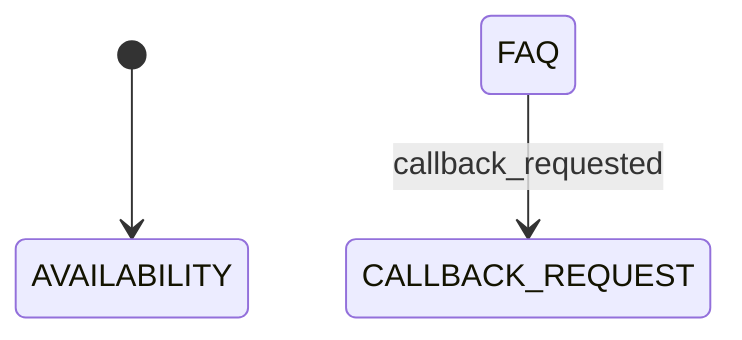

# Flow 6: Questions (FAQ)

- **State machine:** [state_machine.yaml](state_machine.yaml) version 0.2 (the YAML wins if this page disagrees) · **Overview:** [overview.md](overview.md)
- **Golden conversation:** `evals/golden/faq.yaml`

## 1. Purpose and entry
The patient asks about hours, address, services, accepted insurers or dentists, at any point. Entry: global `faq_asked` from any state except `FAQ`, `EMERGENCY`, `BOOK` and `END`. `FAQ` saves `resume_state` and returns there with the built-in `resume` event.

## 2. Diagram
Generated from the YAML (edge label = event, guards in brackets). Global interrupts (emergency, ask for a person, Open Dental down, FAQ, idle timeout) apply in every state and are listed in [overview.md](overview.md#global-interrupts).

## 3. Steps
What the AI says is the *intent* of the reply, not final wording (P2-04 / P2-07 own the text).

| State | What the AI asks or says | Tools | Slots collected | Exits |
|---|---|---|---|---|
| FAQ | Answers from the clinic config only. Then returns to the saved state and repeats its question. | `get_clinic_information`, `get_provider_information` | - | built-in `resume` → `resume_state` (or INTENT); `callback_requested` → callback |

## 4. Failure branches
- Insurance coverage, costs or eligibility (beyond the accepted-insurer list) → offer a callback (P0-01 Q6).
- A question that needs medical judgment → offer a callback; the AI never gives advice.

## 5. Clinic-dependent points
- Insurance: the AI may list accepted insurers only; everything else goes to a callback (P0-01 Q6).
