# Conversation flows: overview

- **State machine:** [state_machine.yaml](state_machine.yaml), version **0.2**, validated by [state_machine.schema.json](state_machine.schema.json). **If this page or a diagram disagrees with the YAML, the YAML wins.**
- **Review record:** [review-2026-11-26.md](review-2026-11-26.md)
- **Flows:** [1 Book (existing)](book-existing-patient.md) · [2 Book (new)](book-new-patient.md) · [3 Reschedule](reschedule.md) · [4 Cancel](cancel.md) · [5 Check appointment](check-appointment.md) · [6 FAQ](faq.md) · [7 Emergency](emergency.md) · [8 Callback](callback.md)
- **Golden conversations:** `evals/golden/<flow>.yaml` (8 files, synthetic)

The conversation is always in exactly one state. Code decides every transition from the YAML; the LLM only proposes an event from the state's closed list and phrases replies (plan §1, §4.1; DECISIONS #155). Flows are the same for voice and text.

## How the engine reads the table (P2-01)
1. **Global transitions first** (table below), unless the current state is in their `except` list.
2. **Local transitions** for `(state, event)` are tried **in file order**; the first whose guards all pass wins. A guarded transition is always listed before its unguarded fallback. An unregistered guard fails closed.
3. **Built-in events** that are not table rows (the schema can't express them): `resume` (a side state is done → `resume_state`, or `INTENT` when none) and `channel_switched` (same state, same slots).
4. **Actions** on transitions (`ask_additional_identifier`, `apologize_and_refetch`, …) name what the handler does; they never change the target state.

## Full state diagram
All 71 local transitions (global interrupts are in the next table, because drawing them from every state would hide the flows).

```mermaid
stateDiagram-v2
    [*] --> GREETING
    GREETING --> INTENT: greeted
    INTENT --> APPOINTMENT_TYPE: intent_book [verified]
    INTENT --> IDENTIFY: intent_book
    INTENT --> RESCHEDULE: intent_reschedule [verified]
    INTENT --> IDENTIFY: intent_reschedule
    INTENT --> CANCEL: intent_cancel [verified]
    INTENT --> IDENTIFY: intent_cancel
    INTENT --> CHECK_APPOINTMENT: intent_check_appointment [verified]
    INTENT --> IDENTIFY: intent_check_appointment
    IDENTIFY --> VERIFY: match_strong
    IDENTIFY --> IDENTIFY: match_partial
    IDENTIFY --> IDENTIFY: match_none
    IDENTIFY --> CALLBACK_REQUEST: match_multiple_unresolved
    VERIFY --> VERIFY: verify_failed
    VERIFY --> CALLBACK_REQUEST: verify_attempt_limit
    VERIFY --> CONSENT: verified [verified, urgent, consent_unknown]
    VERIFY --> CONFIRM: verified [verified, urgent]
    VERIFY --> APPOINTMENT_TYPE: verified [verified, intent_book]
    VERIFY --> RESCHEDULE: verified [verified, intent_reschedule]
    VERIFY --> CANCEL: verified [verified, intent_cancel]
    VERIFY --> CHECK_APPOINTMENT: verified [verified, intent_check_appointment]
    VERIFY --> INTENT: verified
    APPOINTMENT_TYPE --> AVAILABILITY: reason_classified [bookable]
    APPOINTMENT_TYPE --> CALLBACK_REQUEST: not_bookable
    APPOINTMENT_TYPE --> WRAP_UP: not_offered
    AVAILABILITY --> AVAILABILITY: want_later
    AVAILABILITY --> CONSENT: slot_chosen [consent_unknown]
    AVAILABILITY --> CONFIRM: slot_chosen
    AVAILABILITY --> CALLBACK_REQUEST: no_suitable_slot
    CONSENT --> CONFIRM: consent_done
    CONFIRM --> BOOK: confirmed [operation_cancel, verified, confirmation_recorded, outside_cancellation_window]
    CONFIRM --> BOOK: confirmed [verified, fresh_availability, confirmation_recorded]
    CONFIRM --> WRAP_UP: declined [operation_cancel]
    CONFIRM --> AVAILABILITY: declined
    CONFIRM --> CANCEL: change_requested [operation_cancel, verified]
    CONFIRM --> CONSENT: change_requested [target_whatsapp]
    CONFIRM --> APPOINTMENT_TYPE: change_requested [target_reason]
    CONFIRM --> AVAILABILITY: change_requested [target_slot]
    CONFIRM --> AVAILABILITY: change_requested
    BOOK --> WRAP_UP: committed
    BOOK --> AVAILABILITY: commit_conflict
    BOOK --> CALLBACK_REQUEST: commit_unknown
    WRAP_UP --> INTENT: more_help
    WRAP_UP --> END: done
    IDENTIFY --> REGISTER: match_none_confirmed [urgent]
    IDENTIFY --> REGISTER: match_none_confirmed [intent_book]
    IDENTIFY --> CALLBACK_REQUEST: match_none_confirmed
    REGISTER --> REGISTER: change_requested
    REGISTER --> CONSENT: registered [verified, urgent, consent_unknown]
    REGISTER --> CONFIRM: registered [verified, urgent]
    REGISTER --> APPOINTMENT_TYPE: registered [verified]
    REGISTER --> CALLBACK_REQUEST: create_refused
    RESCHEDULE --> AVAILABILITY: reschedule_ready [verified, outside_cancellation_window]
    RESCHEDULE --> CALLBACK_REQUEST: callback_requested
    RESCHEDULE --> WRAP_UP: anything_else
    RESCHEDULE --> WRAP_UP: no_appointments
    CANCEL --> CONFIRM: cancel_ready [verified, outside_cancellation_window]
    CANCEL --> CALLBACK_REQUEST: callback_requested
    CANCEL --> WRAP_UP: anything_else
    CANCEL --> WRAP_UP: no_appointments
    CHECK_APPOINTMENT --> WRAP_UP: appointments_listed
    CHECK_APPOINTMENT --> WRAP_UP: no_appointments
    FAQ --> CALLBACK_REQUEST: callback_requested
    EMERGENCY --> END: session_done
    EMERGENCY --> CONSENT: slot_chosen [verified, consent_unknown]
    EMERGENCY --> CONFIRM: slot_chosen [verified]
    EMERGENCY --> IDENTIFY: slot_chosen
    EMERGENCY --> WRAP_UP: urgent_case_created
    CALLBACK_REQUEST --> CALLBACK_REQUEST: change_requested
    CALLBACK_REQUEST --> WRAP_UP: callback_created
    CALLBACK_REQUEST --> WRAP_UP: callback_declined
    END --> [*]
```

## States
| State | Kind | Allowed tools | Collects |
|---|---|---|---|
| `GREETING` | main | - | - |
| `INTENT` | main | - | `intent` |
| `IDENTIFY` | main | `search_patient` | `first_name`, `last_name`, `dob`, `phone` |
| `VERIFY` | main | `verify_patient` | `zip` |
| `REGISTER` | main | `search_patient`, `create_patient` | `email`, `address`, `mobile_phone` |
| `APPOINTMENT_TYPE` | main | - | `reason_code`, `reason_text` |
| `AVAILABILITY` | main | `get_appointment_availability` | `preferred_time`, `chosen_slot` |
| `CONSENT` | main | `record_consent` | `consent_whatsapp`, `whatsapp_number` |
| `CONFIRM` | main | - | `confirmation` |
| `BOOK` | main | `book_appointment`, `reschedule_appointment`, `cancel_appointment` | `apt_num` |
| `WRAP_UP` | main | - | - |
| `CHECK_APPOINTMENT` | side | `get_patient_appointments` | - |
| `RESCHEDULE` | side | `get_patient_appointments` | `apt_num`, `reason_code` |
| `CANCEL` | side | `get_patient_appointments` | `apt_num` |
| `FAQ` | side (resumes) | `get_clinic_information`, `get_provider_information` | - |
| `EMERGENCY` | side | `create_callback_request`, `get_appointment_availability` | `situation`, `chosen_slot`, `first_name`, `phone` |
| `CALLBACK_REQUEST` | side | `create_callback_request` | `situation`, `callback_time`, `first_name`, `last_name`, `phone` |
| `END` | terminal | - | - |

## Global interrupts
| Event | Next state | Applies | Notes |
|---|---|---|---|
| `emergency_tier1`, `emergency_crisis` | EMERGENCY | every state except END | From `BOOK` only after the running tool call returns. Never resumes (`resume_state` cleared). |
| `emergency_uncertain`, `emergency_tier2` | EMERGENCY | not from EMERGENCY, END | Fires only when more severe than the session's highest result (P2-20). |
| `human_requested` | CALLBACK_REQUEST | not from CALLBACK_REQUEST, EMERGENCY, END | "Can I talk to a person?" or a yes to the complaint offer (DECISIONS #170). No live transfer. |
| `not_understood_limit` | CALLBACK_REQUEST | not from CALLBACK_REQUEST, EMERGENCY, END | `conversation.not_understood_limit` failed attempts in the same state (default 2, DECISIONS #157). |
| `od_unavailable` | CALLBACK_REQUEST | not from CALLBACK_REQUEST, EMERGENCY, END | Open Dental down or a tool failed after retries. |
| `intent_changed` | INTENT | not from EMERGENCY, CALLBACK_REQUEST, BOOK, END | "Actually, I want to cancel." Slots and verification are kept. |
| `faq_asked` | FAQ | not from FAQ, EMERGENCY, BOOK, END | Saves `resume_state`; the built-in `resume` returns there. |
| `idle_timeout` | END | not from END | Timeout owned by P1-14. A half-finished operation is never committed. |
| `add_patient` | IDENTIFY | not from EMERGENCY, CALLBACK_REQUEST, BOOK, END | "I also want to book for my son." The handler checks that the active person is verified and fewer than 4 persons exist (global transitions have no guards in the schema); otherwise reply `household_full` / ask to verify first (DECISIONS #185). |
| `switch_patient` | INTENT | not from EMERGENCY, BOOK, END | Only to a person already verified in this session; no re-verification (DECISIONS #185). |
| `channel_switched` (built-in) | same state | every state | Voice ↔ text never changes state or slots. |

Verification limit: `verification.max_attempts` (default 3), counted across the whole session including household members; reaching it fires `verify_attempt_limit` → `CALLBACK_REQUEST` (DECISIONS #157, #185).

## Guards
| Guard | True when | Enforced by |
|---|---|---|
| `verified` | A PatNum is verified in this session, or was created by `REGISTER` in this session (for the active person) | P2-08 (absorbs P2-09), P1-13 |
| `fresh_availability` | `chosen_slot` came from a `get_appointment_availability` result in this session that hasn't since been invalidated by a conflict | P2-08 |
| `confirmation_recorded` | The patient gave an explicit yes on the card to exactly the operation being committed (operation hash) | P2-08 |
| `outside_cancellation_window` | The appointment starts later than the clinic's minimum notice (24 hours, P0-01 Q5) | P2-18 |
| `bookable` | The reason code maps to a variant the AI may book (P0-02) | P1-19, P2-16 |
| `consent_unknown` | No WhatsApp consent decision exists for this PatNum and number, and none was given earlier in this chat | P4-02 |
| `urgent` | Slot memory `urgent` is true (Tier 2 path, P0-03) | P2-20 |
| `intent_book / intent_reschedule / intent_cancel / intent_check_appointment` | Slot memory `intent` has that value; used after `verified` / `registered` to continue the kept intent | P2-01 |
| `operation_cancel` | Slot memory `operation` is `cancel` (cancel uses `CONFIRM` / `BOOK` without availability or consent) | P2-18 |
| `target_slot / target_reason / target_whatsapp` | The `change_requested` target named by the patient on the card (DECISIONS #174) | P2-16, P4-02 |

## Slots
All slots except `intent` are **person-scoped** in slot memory (`p{index}:{slot}`, up to 4 persons per chat, DECISIONS #185); this is an engine concern (P2-01), not a YAML field. PHI slots are encrypted in slot memory (P2-01) and masked in model context (P2-04).

| Slot | PHI | Collected in |
|---|---|---|
| `intent` | no | `INTENT` |
| `operation` | no | set by code |
| `urgent` | no | set by code |
| `resume_state` | no | set by code |
| `active_person` | no | set by code |
| `first_name` | **yes** | `IDENTIFY`, `EMERGENCY`, `CALLBACK_REQUEST` |
| `last_name` | **yes** | `IDENTIFY`, `CALLBACK_REQUEST` |
| `dob` | **yes** | `IDENTIFY` |
| `phone` | **yes** | `IDENTIFY`, `EMERGENCY`, `CALLBACK_REQUEST` |
| `zip` | **yes** | `VERIFY` |
| `email` | **yes** | `REGISTER` |
| `address` | **yes** | `REGISTER` |
| `mobile_phone` | **yes** | `REGISTER` |
| `reason_code` | no | `APPOINTMENT_TYPE`, `RESCHEDULE` |
| `reason_text` | **yes** | `APPOINTMENT_TYPE` |
| `preferred_time` | no | `AVAILABILITY` |
| `chosen_slot` | no | `AVAILABILITY`, `EMERGENCY` |
| `confirmation` | no | `CONFIRM` |
| `apt_num` | no | `BOOK`, `RESCHEDULE`, `CANCEL` |
| `consent_whatsapp` | no | `CONSENT` |
| `whatsapp_number` | **yes** | `CONSENT` |
| `situation` | **yes** | `EMERGENCY`, `CALLBACK_REQUEST` |
| `callback_time` | no | `CALLBACK_REQUEST` |

## Resume rules
- `FAQ` (`resumes: true`) saves `resume_state` and returns there with `resume`, repeating that state's question; `chosen_slot` and other slots are kept.
- `EMERGENCY` from `uncertain` returns with `resume` after the URGENT case; from `tier1` / `crisis` it never returns (`resume_state` cleared); `tier2` continues as an urgent booking.
- `intent_changed` and `switch_patient` go to `INTENT` with all slots and verification kept.
- `idle_timeout` ends the session; nothing half-finished is written.

## PHI list for P0-14 (data-flow diagram)
Every PHI slot, the state(s) that collect it and the tools it is sent to. All patient turns also pass through Gemini on Vertex AI (under the Google Cloud BAA) for extraction, with PHI masked where P2-04 allows.

| PHI slot | Collected in | Sent to tools |
|---|---|---|
| `first_name` | `IDENTIFY`, `EMERGENCY`, `CALLBACK_REQUEST` | `search_patient`, `verify_patient`, `create_patient`, `create_callback_request` |
| `last_name` | `IDENTIFY`, `CALLBACK_REQUEST` | `search_patient`, `verify_patient`, `create_patient`, `create_callback_request` |
| `dob` | `IDENTIFY` | `search_patient`, `verify_patient`, `create_patient` |
| `phone` | `IDENTIFY`, `EMERGENCY`, `CALLBACK_REQUEST` | `search_patient`, `verify_patient`, `create_callback_request` |
| `zip` | `VERIFY` | `verify_patient` |
| `email` | `REGISTER` | `create_patient` |
| `address` | `REGISTER` | `create_patient` |
| `mobile_phone` | `REGISTER` | `create_patient` |
| `reason_text` | `APPOINTMENT_TYPE` | none (classified into `reason_code` by code and config; may go into a callback summary via `create_callback_request`) |
| `whatsapp_number` | `CONSENT` | `record_consent`, by reference only (never a tool argument, DECISIONS #256) |
| `situation` | `EMERGENCY`, `CALLBACK_REQUEST` | `create_callback_request` (encrypted case summary) |

## Pending notifications
These GitHub issues don't exist yet. When each is created, comment on it with the paths (`docs/flows/state_machine.yaml`, `docs/flows/overview.md`, the flow document, `evals/golden/`) and version **0.2**.

| Task | What it relies on | Posted on issue (date) |
|---|---|---|
| P2-01 State machine core (absorbs P2-02) | The whole YAML; consistency rules to unit-test; built-ins `resume` / `channel_switched`; `add_patient` / `switch_patient` conditions in the handler; person-scoped slots | - |
| P2-05 Intent and slot extraction | Intent values (`book`, `reschedule`, `cancel`, `check_appointment`, `faq`, `talk_to_human`, `complaint`, `other`) and the per-state event lists | - |
| P2-08 Tool gateway (absorbs P2-09) | `allowed_tools` per state, the guards and which transitions need them; `record_consent` in the tool list | - |
| P2-12 Identification and verification (absorbs P2-13, P2-14) | Flows 1, 3–5: `match_*`, `verified`, `verify_failed`, `verify_attempt_limit`; household checks | - |
| P2-15 New patient registration | Flow 2: `registered`, `create_refused` confirmed | - |
| P2-16 Booking flow (absorbs P2-17) | Flows 1 and 5; consent order per #256 (its spec still shows `BOOK → CONSENT`); `commit_unknown` | - |
| P2-18 Reschedule and cancel | Flows 3, 4 and 6: `reschedule_ready`, `cancel_ready`, `callback_requested`, `anything_else`, `commit_unknown` | - |
| P2-20 Emergency detector (absorbs P2-21) | Flow 7: Tier 2 slot first, then identify; `session_done`, `urgent_case_created` | - |
| P2-22 Callback service (absorbs P2-24) | Flow 8: `callback_created`, `callback_declined` | - |
| P4-02 Consent capture (with P1-22) | The `CONSENT` state and the `record_consent` tool (P1-22 must list it) | - |
| P0-14 Architecture and PHI data flow | The PHI list above | - |
| P5-01 Eval harness (absorbs P5-02) | The 8 golden conversations in `evals/golden/` | - |
