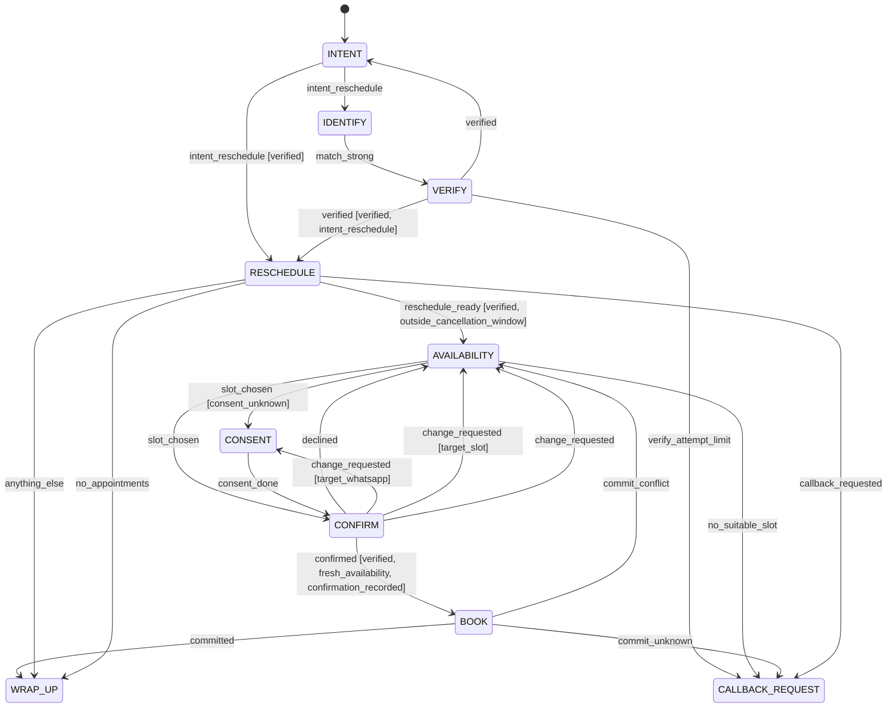

# Flow 3: Reschedule an appointment

- **State machine:** [state_machine.yaml](state_machine.yaml) version 0.2 (the YAML wins if this page disagrees) · **Overview:** [overview.md](overview.md)
- **Golden conversation:** `evals/golden/reschedule.yaml`

## 1. Purpose and entry
A verified patient moves an existing appointment. Entry: intent `reschedule`. Unverified → `IDENTIFY` and `VERIFY` first, intent kept.

## 2. Diagram
Generated from the YAML (edge label = event, guards in brackets). Global interrupts (emergency, ask for a person, Open Dental down, FAQ, idle timeout) apply in every state and are listed in [overview.md](overview.md#global-interrupts).

## 3. Steps
What the AI says is the *intent* of the reply, not final wording (P2-04 / P2-07 own the text).

| State | What the AI asks or says | Tools | Slots collected | Exits |
|---|---|---|---|---|
| RESCHEDULE | Lists this patient's upcoming appointments; asks which one; checks the notice window. | `get_patient_appointments` | `apt_num`, `reason_code` | `reschedule_ready [verified, outside_cancellation_window]` → AVAILABILITY; inside the window → offer a callback (`callback_requested` → callback, `anything_else` → WRAP_UP); `no_appointments` → WRAP_UP |
| AVAILABILITY … CONFIRM | As in flow 1 with `operation=reschedule`; the card shows the old and the new time. | as flow 1 | as flow 1 | as flow 1 |
| BOOK | Moves the appointment in Open Dental. | `reschedule_appointment` | `apt_num` | `committed` → WRAP_UP; `commit_conflict` → AVAILABILITY |

## 4. Failure branches
- Inside the 24-hour notice window → no change; offer a callback (P0-01 Q5).
- Outcome unknown after the write → `CALLBACK_REQUEST` (`commit_unknown`, reason `change_needs_confirmation`).
- Plus the identify/verify and availability failures of flow 1.

## 5. Clinic-dependent points
- Notice window: 24 hours; inside it the AI doesn't reschedule and creates a callback (P0-01 Q5).
